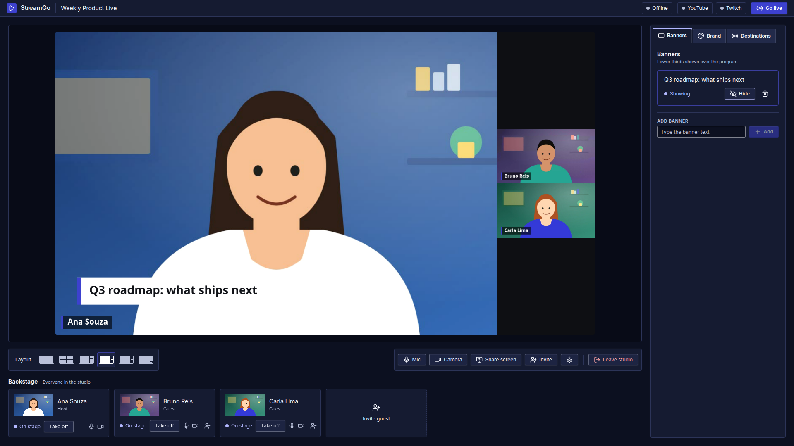
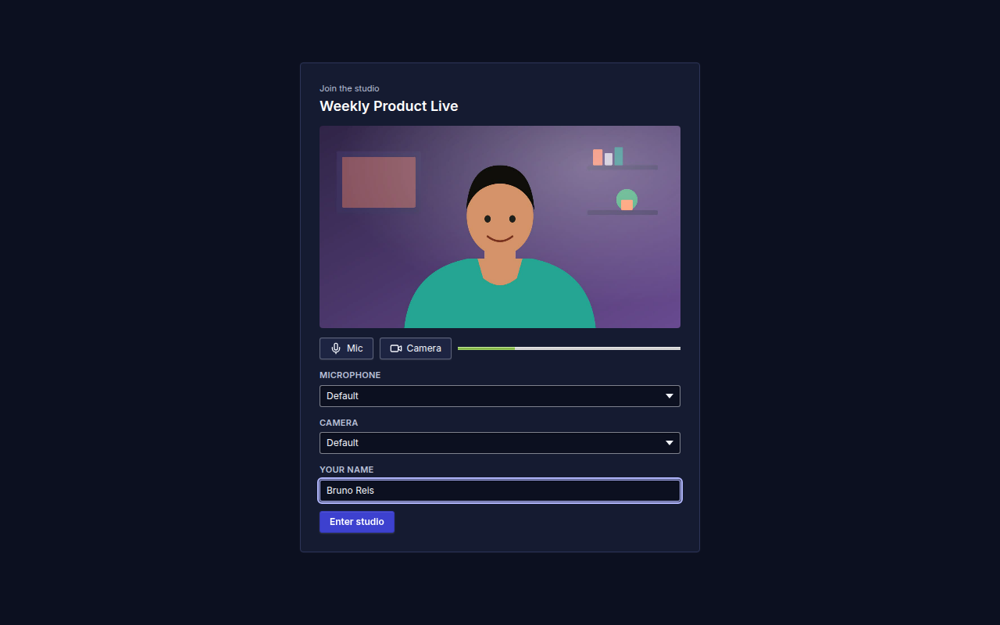
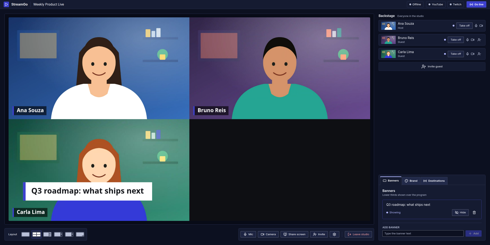
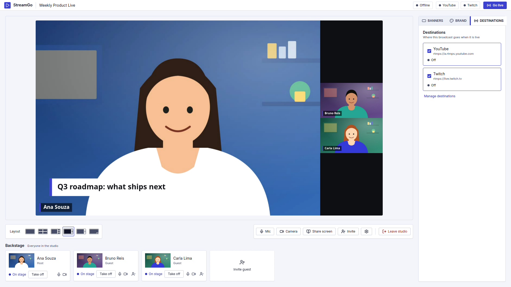
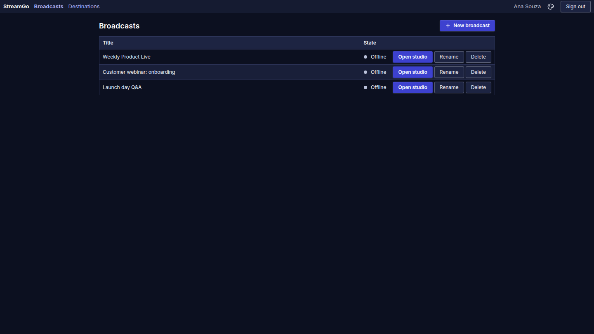

<p align="center">
  <picture>
    <source media="(prefers-color-scheme: dark)" srcset="docs/images/logo-dark.svg">
    
  </picture>
</p>

<p align="center">
  <b>Your own live-streaming studio — in the browser, on your server.</b><br>
  Invite guests with a link, arrange the stage, add your logo and banners,<br>
  and go live to YouTube, Twitch and any RTMP destination at the same time.
</p>

<p align="center">
  <a href="https://github.com/jniltinho/streamgo/releases/latest"></a>
  <a href="https://github.com/jniltinho/streamgo/actions/workflows/ci.yml"></a>
  <a href="https://github.com/jniltinho/streamgo/releases"></a>
  <a href="https://go.dev/"></a>
  <a href="LICENSE"></a>
  <a href="https://github.com/jniltinho/streamgo/stargazers"></a>
</p>

<p align="center">
  <a href="#-try-it-in-one-minute">Try it</a> ·
  <a href="#-screenshots">Screenshots</a> ·
  <a href="#-what-you-get">Features</a> ·
  <a href="docs/README.md">Documentation</a> ·
  <a href="https://github.com/jniltinho/streamgo/releases/latest">Download</a>
</p>

<p align="center">
  
</p>

## ✨ Why creators and teams pick it

- 🏠 **Your studio, your server** — StreamGo runs on a machine you control. Your guests, your stream keys and your
  broadcasts never pass through someone else's service.
- 💸 **No monthly plan, no watermark** — open source under the MIT license. No seat limits, no "upgrade to remove
  the logo", no hours-per-month cap.
- 👋 **Guests join with a link** — no account and nothing to install: they open the link, check camera and
  microphone, type a name and wait backstage until you put them on stage.
- 📡 **Live everywhere at once** — send the same program to YouTube, Twitch, your own RTMP server, or all of
  them. Switch a destination on or off while you are live; one that fails is retried without touching the others.
- 🎬 **What you see is what goes out** — the stage in your browser is the program: layouts, name tags, your logo and
  lower-third banners are drawn exactly as viewers get them.
- ⚡ **One package, running in a minute** — one container or one `.deb`/`.rpm` is a complete install. Upgrades are
  "install and restart"; the database migrates itself.

## 🚀 Try it in one minute

**With Docker** — one container with StreamGo, the media servers and ffmpeg; everything is kept on one volume:

```bash
docker run -d --name streamgo --stop-timeout 50 -v streamgo-data:/data -p 8080:8080 -p 7881:7881 -p 7882:7882/udp -p 8189:8189 -p 8189:8189/udp ghcr.io/jniltinho/streamgo:allinone
```

Create your account (it asks for a password), then open `http://localhost:8080` in Chrome or Edge:

```bash
docker exec -it streamgo streamgo user add --email you@example.com --name "Your Name"
```

**On a server** (Ubuntu 26.04 or Debian 13, x86_64) — a package that installs StreamGo and its media servers in
`/opt/streamgo` as systemd services. The first line finds the newest version; the files are also on the
[releases page](https://github.com/jniltinho/streamgo/releases/latest):

```bash
VERSION=$(curl -fsSL -o /dev/null -w '%{url_effective}' https://github.com/jniltinho/streamgo/releases/latest | sed 's|.*/v||')
```

```bash
curl -fLO "https://github.com/jniltinho/streamgo/releases/download/v${VERSION}/streamgo_${VERSION}_amd64.deb"
```

```bash
sudo apt install "./streamgo_${VERSION}_amd64.deb"
```

Then [create the first user](docs/install-linux.md#4-create-the-first-user) and open the address of your server.
To use it from other machines you need HTTPS (browsers only give a page the camera on a secure origin) and the
media ports open: the [install guide](docs/install-linux.md) walks through both, and StreamGo can
[serve HTTPS by itself](docs/standalone-https.md), with a certificate you bring or one it generates.

An `.rpm` (AlmaLinux, Rocky Linux, RHEL) and a `.tar.gz` are in the
[releases](https://github.com/jniltinho/streamgo/releases/latest) too. Docker Compose, MariaDB or PostgreSQL,
a reverse proxy and everything else: **[documentation](docs/README.md)**.

## 📸 Screenshots

| Guests check in before they join | The whole screen for the show |
|----------------------------------|-------------------------------|
|  |  |

| Light, dark and 20 more themes | All your broadcasts in one place |
|--------------------------------|----------------------------------|
|  |  |

All screens use fictional people and data.

## 🧩 What you get

| | |
|---|---|
| 🎥 **Studio in the browser** | Cameras and shared screens, up to 6 on stage at once, six layouts (solo, grid, sidebar, picture-in-picture and more), switched live with one click. |
| 🧑‍🤝‍🧑 **Backstage** | Everyone who joined waits backstage with a live preview and a mark that shows who is speaking. You decide who goes on air, and when. |
| 🏷️ **Your brand on the program** | Your logo, your accent colour, name tags and lower-third banners you prepare ahead and show when the moment comes. |
| 📡 **Multistreaming** | Several RTMP and RTMPS destinations per broadcast (up to 20 saved per account), each with its own status. YouTube, Twitch, Facebook and Instagram come ready: you only paste the stream key. Stream keys are encrypted at rest and never shown again. |
| 🔁 **Made to stay on air** | A destination that drops is retried on its own; a program that disappears pauses the broadcast and resumes it when it is back, even across a server restart. |
| 🖥️ **From Full HD to 4K monitors** | The interface scales with your screen, and in a wide window the program takes the whole height. The stream goes out in 720p or 1080p at 30 fps. |
| 🎨 **22 themes, two languages** | Light and dark, plus 20 more themes. English and Brazilian Portuguese. Keyboard and screen-reader friendly. |
| 🗄️ **Your database** | SQLite out of the box; MariaDB or PostgreSQL with one setting. |
| 🔒 **HTTPS included** | StreamGo serves HTTPS itself, with your certificate or a self-signed one, or sits behind nginx or Caddy. |
| 📦 **Runs your way** | A `.deb`, an `.rpm`, a single Docker image, Docker Compose or the plain binary — all for linux/amd64. |

## 🎬 How a broadcast goes

1. **Create a broadcast** and choose where it goes: pick the platform (or paste an RTMP address) and its stream key, once.
2. **Open the studio** and send the invite link to your guests. They arrive backstage.
3. **Arrange the stage**: put people and screens on it, pick a layout, show a banner.
4. **Go live.** Every destination shows its own status; end the broadcast when you are done, and go live again
   later with the same studio and the same link.

## 📌 Good to know

StreamGo is in its first version. So you can plan around it:

- **The host needs a desktop Chromium-based browser** (Chrome, Edge, Brave). Guests can use any current browser,
  Firefox and Safari included. The program is composed in the host's browser, so the broadcast depends on that tab
  staying open.
- **The media ports must be reachable** from your guests' networks: there is no TURN server in this version, so a
  network that allows only web traffic cannot take part.
- **Not included yet**: recordings, and output above 1080p.

The details are in the [documentation](docs/README.md#where-it-stands) and the
[architecture guide](docs/architecture.md#limits).

## 📚 Documentation

Everything else lives in **[docs/README.md](docs/README.md)**: the install guides for
[packages](docs/install-linux.md), [Docker](docs/install-docker.md) and [the binary](docs/install-binary.md),
[HTTPS](docs/standalone-https.md), [reverse proxies](docs/reverse-proxy.md), the
[architecture](docs/architecture.md), the [security model](docs/security.md), and how to
[build and develop](docs/README.md#for-developers) StreamGo. What each release brings is in the
[changelog](CHANGELOG.md).

## 🙏 Built on

[LiveKit](https://livekit.io) hosts the studio room, [MediaMTX](https://github.com/bluenviron/mediamtx) receives
the program and [FFmpeg](https://ffmpeg.org) encodes and delivers it. The project layout and the theme catalog come
from [MeetHub](https://github.com/jniltinho/meethub). Licences are in [LICENSE](LICENSE), [NOTICE](NOTICE) and
[THIRD_PARTY](THIRD_PARTY).

## 📄 License

[MIT](LICENSE).
