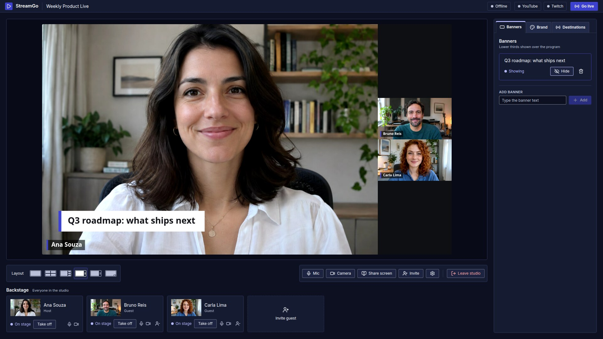
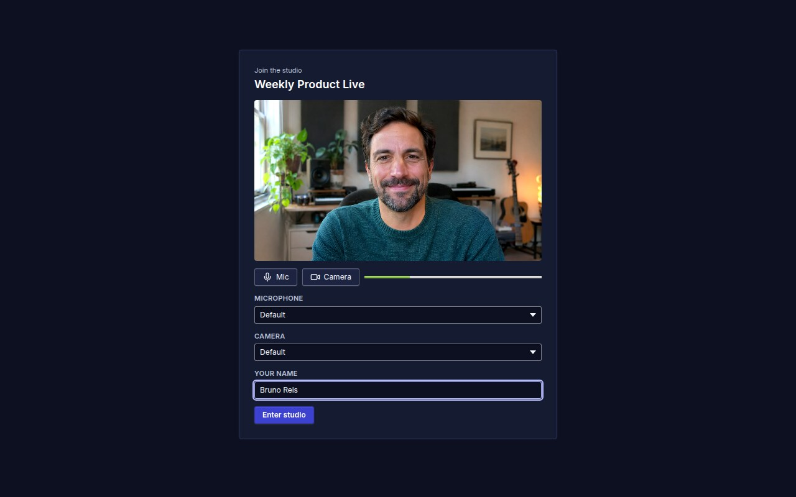

<p align="center">
  <picture>
    <source media="(prefers-color-scheme: dark)" srcset="docs/images/logo-dark.svg">
    
  </picture>
</p>

<p align="center">
  <b>Your own live-streaming studio — in the browser, on your server.</b><br>
  Invite guests with a link, arrange the stage, add your logo and banners,<br>
  and go live to YouTube, Twitch, Facebook and any RTMP destination at the same time.
</p>

<p align="center">
  <a href="https://github.com/jniltinho/streamgo/releases/latest"></a>
  <a href="https://github.com/jniltinho/streamgo/actions/workflows/ci.yml"></a>
  <a href="https://github.com/jniltinho/streamgo/pkgs/container/streamgo"></a>
  <a href="LICENSE"></a>
  <a href="https://github.com/jniltinho/streamgo/stargazers"></a>
</p>

<p align="center">
  <a href="#-quick-start">Quick start</a> ·
  <a href="#-what-you-get">Features</a> ·
  <a href="#-screenshots">Screenshots</a> ·
  <a href="docs/README.md">Documentation</a> ·
  <a href="https://github.com/jniltinho/streamgo/releases/latest">Download</a>
</p>

<p align="center">
  
</p>

## ✨ Why StreamGo

- 🏠 **Your studio, your server** — your guests, your stream keys and your broadcasts stay on a machine you control.
- 💸 **No monthly plan, no watermark** — open source under the MIT license: no price per seat, no hours-per-month cap.
- 👋 **Guests join with a link** — no account, nothing to install. They wait backstage until you put them on air.
- 📡 **Live everywhere at once** — one program to several destinations, each with its own status and retried on its own.

## 🚀 Quick start

**With Docker**: one container from the [GitHub Container Registry](https://github.com/jniltinho/streamgo/pkgs/container/streamgo),
with StreamGo, its media servers and ffmpeg inside:

```bash
docker run -d --name streamgo --stop-timeout 50 -v streamgo-data:/data -p 8080:8080 -p 7881:7881 -p 7882:7882/udp -p 8189:8189 -p 8189:8189/udp ghcr.io/jniltinho/streamgo:allinone
```

Wait a few seconds until `docker ps` shows the container as `healthy`, then create your account (it asks for a
password):

```bash
docker exec -it streamgo streamgo user add --email you@example.com --name "Your Name"
```

**Without Docker**: one file on a linux/amd64 host, run as your normal user (not root). It carries StreamGo,
LiveKit and MediaMTX; ffmpeg comes from your distribution:

```bash
curl -Lo streamgo https://github.com/jniltinho/streamgo/releases/download/v0.5.0/streamgo_0.5.0_linux_amd64
```

```bash
chmod +x streamgo && sudo apt install ffmpeg
```

```bash
./streamgo up
```

`streamgo up` creates its secrets and its database under `./data` and keeps running. In a second terminal, in the
same directory, create your account (it asks for a password):

```bash
./streamgo user add --email you@example.com --name "Your Name"
```

Either way, open **http://localhost:8080** in Chrome or Edge, sign in, create a broadcast and open its studio.
The first account is the administrator: it creates the other accounts on the **Users** page. That is all for a
first look on your own machine.

To put it on a server for guests elsewhere, follow the guides:
[the single file](docs/install-single.md) ·
[Docker and Docker Compose](docs/install-docker.md) ·
[`.deb` and `.rpm` packages](docs/install-linux.md) ·
[HTTPS](docs/standalone-https.md) ·
[all documentation](docs/README.md)

### Downloads

Every [release](https://github.com/jniltinho/streamgo/releases/latest) publishes these files for linux/amd64, with
their `SHA256SUMS`:

| File | Size | What it holds | For |
|---|---|---|---|
| `streamgo_<version>_linux_amd64` | 68 MB | One executable: StreamGo with LiveKit and MediaMTX inside; `streamgo up` runs the three | Trying StreamGo or running it on one host without Docker or a package ([guide](docs/install-single.md)) |
| `streamgo_<version>_amd64.deb` | 66 MB | StreamGo, LiveKit and MediaMTX in `/opt/streamgo` as three systemd services | Debian and Ubuntu servers ([guide](docs/install-linux.md)) |
| `streamgo-<version>-1.x86_64.rpm` | 79 MB | The same, for the RHEL family | AlmaLinux, Rocky Linux and RHEL servers ([guide](docs/install-linux.md#the-rpm-almalinux-rocky-linux-and-the-rhel-family)) |
| `streamgo_<version>_linux_amd64.tar.gz` | 79 MB | The files of the packages: the three programs, their settings and the systemd units | Other distributions with systemd ([guide](docs/install-binary.md)) |
| `streamgo-server_<version>_linux_amd64.tar.gz` | 14 MB | StreamGo alone: the executable, the example configuration and the notices | A host that already runs LiveKit and MediaMTX |
| `ghcr.io/jniltinho/streamgo:<version>-allinone` | about 150 MB to pull | The three programs and ffmpeg in one container | Docker on one host ([guide](docs/install-docker.md#the-all-in-one-image)) |

The single file and the StreamGo-only archive come with 0.4.0; earlier releases have the other four.

## 🧩 What you get

| | |
|---|---|
| 🎥 **Studio in the browser** | Cameras and shared screens, up to 6 on stage, six layouts switched live with one click. |
| 🧑‍🤝‍🧑 **Backstage** | Up to 10 people in a studio by default (100 at most). Everyone who joined waits backstage; the host sees a live preview of each one and who is speaking, and decides who goes on air. |
| 🏷️ **Your brand** | Your logo, your accent colour, name tags and lower-third banners prepared ahead and shown at the right moment. |
| 📡 **Multistreaming** | Up to 5 RTMP or RTMPS destinations per broadcast by default (10 at most). The form fills in the usual address of YouTube, Twitch, Facebook and Instagram; you check it and paste the stream key, which is encrypted at rest. |
| 🔁 **Made to stay on air** | A destination that drops is retried; a program that disappears pauses the broadcast, which resumes when it is back within two minutes (the default), even across a server restart. |
| 🖥️ **Any screen** | The interface scales from Full HD to 4K monitors and uses the whole window. Each broadcast goes out in 720p, 1080p or 1440p (QHD) at 30 fps, chosen in the studio up to the limit an administrator sets. |
| 🎨 **28 themes, two languages** | Light, dark and 26 more themes; English and Brazilian Portuguese; every control reachable by keyboard, with automated accessibility checks. |
| 👥 **Accounts** | The first account is the administrator; administrators create the other accounts, change their role or password, and disable them in the web app. There is no public sign-up. |
| 📦 **Runs your way** | One file, one Docker image, Docker Compose, a `.deb`, an `.rpm` or an archive (linux/amd64), with SQLite, MariaDB or PostgreSQL. |

## 📸 Screenshots

| Guests check in before they join | The whole window for the show |
|----------------------------------|-------------------------------|
|  |  |

<p align="center">
  
</p>

The people in these screens are not real: their pictures were generated for this page.

## 📌 Good to know

What to plan around in the current version:

- **The host needs a desktop Chromium-based browser** (Chrome, Edge, Brave). The program is composed in the host's
  browser, so the broadcast depends on that tab staying open; it resumes when the tab is back within two minutes
  (the default). Guests were tested in Chrome and Firefox.
- **Guests on other machines need HTTPS**: browsers allow the camera and the microphone only on `https://` or on
  `localhost`. StreamGo can serve HTTPS itself, with a self-signed certificate or yours.
- **The media ports must be reachable** from the networks of the host and the guests (7881/tcp, 7882/udp and
  8189 over TCP and UDP): there is no TURN server, so a network that allows only web traffic cannot take part.
- **Not included**: recordings, output above 1440p (4K was measured and the host's browser could not keep up),
  more than one StreamGo process per install, and hosts other than linux/amd64.
- **1440p is opt-in**: the highest resolution is 1080p until an administrator raises it in Settings → Server (or
  the operator sets `output.max_resolution`). A live 1440p broadcast needs about two server cores and up to
  24 Mbit/s of the host's upload.
- **Not verified yet**: the live output is tested against an RTMP test server. Long broadcasts to the public
  platforms, a server behind NAT reached from another network, and the host's window minimized on a real desktop
  (it passed in an emulation) have not been checked.

More in the [documentation](docs/README.md#where-it-stands) and the [architecture guide](docs/architecture.md#limits).

## 📚 Documentation and license

Install guides, HTTPS, reverse proxies, the architecture, the security model and how to build StreamGo are in
**[docs/README.md](docs/README.md)**; what each release brings is in the [changelog](CHANGELOG.md).

StreamGo is released under the [MIT license](LICENSE). It builds on [LiveKit](https://livekit.io),
[MediaMTX](https://github.com/bluenviron/mediamtx) and [FFmpeg](https://ffmpeg.org), and takes its layout and theme
catalog from [MeetHub](https://github.com/jniltinho/meethub) ([NOTICE](NOTICE), [THIRD_PARTY](THIRD_PARTY)).
