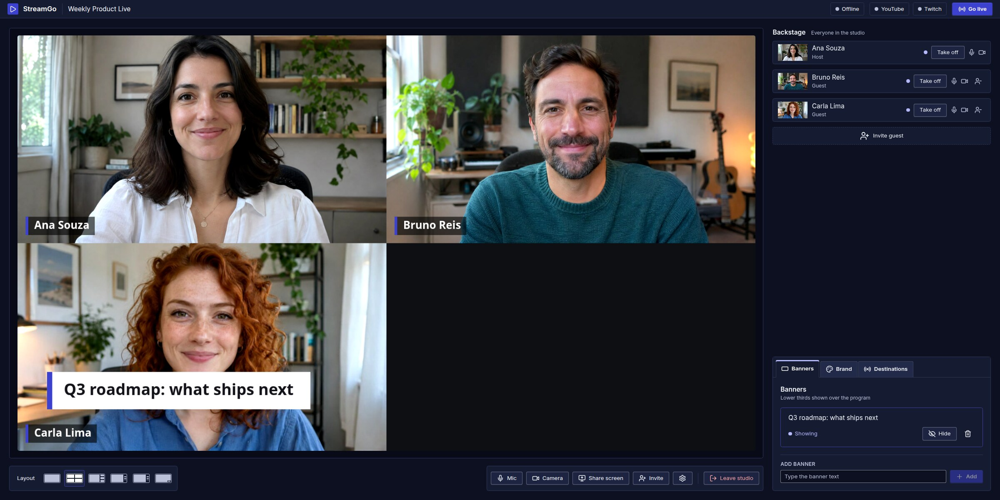
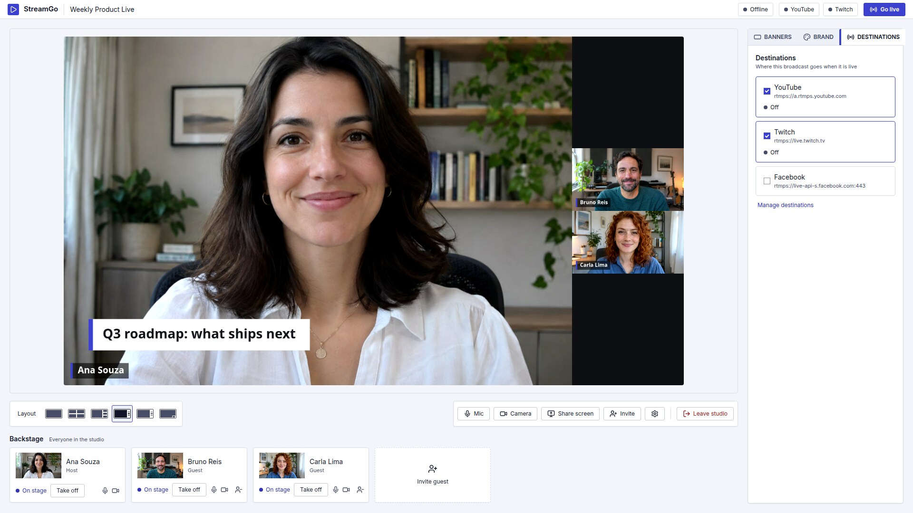

<p align="center">
  <picture>
    <source media="(prefers-color-scheme: dark)" srcset="docs/images/logo-dark.svg">
    
  </picture>
</p>

<p align="center">
  <b>Your own live-streaming studio — in the browser, on your server.</b><br>
  Invite guests with a link, arrange the stage, add your logo and banners,<br>
  and go live to YouTube, Twitch, Facebook and any RTMP destination at the same time.
</p>

<p align="center">
  <a href="https://github.com/jniltinho/streamgo/releases/latest"></a>
  <a href="https://github.com/jniltinho/streamgo/actions/workflows/ci.yml"></a>
  <a href="https://github.com/jniltinho/streamgo/pkgs/container/streamgo"></a>
  <a href="LICENSE"></a>
  <a href="https://github.com/jniltinho/streamgo/stargazers"></a>
</p>

<p align="center">
  <a href="#-quick-start">Quick start</a> ·
  <a href="#-what-you-get">Features</a> ·
  <a href="#-screenshots">Screenshots</a> ·
  <a href="docs/README.md">Documentation</a> ·
  <a href="https://github.com/jniltinho/streamgo/releases/latest">Download</a>
</p>

<p align="center">
  
</p>

## ✨ Why StreamGo

- 🏠 **Your studio, your server** — your guests, your stream keys and your broadcasts stay on a machine you control.
- 💸 **No monthly plan, no watermark** — open source under the MIT license: no seat limits, no hours-per-month cap.
- 👋 **Guests join with a link** — no account, nothing to install. They wait backstage until you put them on air.
- 📡 **Live everywhere at once** — one program to several destinations, each with its own status and retried on its own.

## 🚀 Quick start

One container from the [GitHub Container Registry](https://github.com/jniltinho/streamgo/pkgs/container/streamgo),
with StreamGo, its media servers and ffmpeg inside:

```bash
docker run -d --name streamgo --stop-timeout 50 -v streamgo-data:/data -p 8080:8080 -p 7881:7881 -p 7882:7882/udp -p 8189:8189 -p 8189:8189/udp ghcr.io/jniltinho/streamgo:allinone
```

Create your account (it asks for a password):

```bash
docker exec -it streamgo streamgo user add --email you@example.com --name "Your Name"
```

Open **http://localhost:8080** in Chrome or Edge, sign in, create a broadcast and open its studio. That is all for
a first look on your own machine.

To put it on a server for guests elsewhere, or to install without Docker, follow the guides:
[Docker and Docker Compose](docs/install-docker.md) ·
[`.deb` and `.rpm` packages](docs/install-linux.md) ·
[HTTPS](docs/standalone-https.md) ·
[all documentation](docs/README.md)

## 🧩 What you get

| | |
|---|---|
| 🎥 **Studio in the browser** | Cameras and shared screens, up to 6 on stage, six layouts switched live with one click. |
| 🧑‍🤝‍🧑 **Backstage** | Everyone who joined waits backstage with a live preview and a mark that shows who is speaking. You decide who goes on air. |
| 🏷️ **Your brand** | Your logo, your accent colour, name tags and lower-third banners prepared ahead and shown at the right moment. |
| 📡 **Multistreaming** | RTMP and RTMPS destinations per broadcast. YouTube, Twitch, Facebook and Instagram come ready: you only paste the stream key, which is encrypted at rest. |
| 🔁 **Made to stay on air** | A destination that drops is retried; a program that disappears pauses the broadcast and resumes it, even across a server restart. |
| 🖥️ **Any screen** | The interface scales from Full HD to 4K monitors and uses the whole window. The stream goes out in 720p or 1080p at 30 fps. |
| 🎨 **22 themes, two languages** | Light, dark and 20 more themes; English and Brazilian Portuguese; keyboard and screen-reader friendly. |
| 📦 **Runs your way** | One Docker image, Docker Compose, a `.deb`, an `.rpm` or the plain binary (linux/amd64), with SQLite, MariaDB or PostgreSQL. |

## 📸 Screenshots

| Guests check in before they join | The whole window for the show |
|----------------------------------|-------------------------------|
|  |  |

<p align="center">
  
</p>

The people in these screens are not real: their pictures were generated for this page.

## 📌 Good to know

This is the first version. So you can plan around it:

- **The host needs a desktop Chromium-based browser** (Chrome, Edge, Brave); guests can use any current browser.
  The program is composed in the host's browser, so the broadcast depends on that tab staying open.
- **The media ports must be reachable** from your guests' networks: there is no TURN server yet.
- **Not included yet**: recordings, and output above 1080p.

More in the [documentation](docs/README.md#where-it-stands) and the [architecture guide](docs/architecture.md#limits).

## 📚 Documentation and license

Install guides, HTTPS, reverse proxies, the architecture, the security model and how to build StreamGo are in
**[docs/README.md](docs/README.md)**; what each release brings is in the [changelog](CHANGELOG.md).

StreamGo is released under the [MIT license](LICENSE). It builds on [LiveKit](https://livekit.io),
[MediaMTX](https://github.com/bluenviron/mediamtx) and [FFmpeg](https://ffmpeg.org), and takes its layout and theme
catalog from [MeetHub](https://github.com/jniltinho/meethub) ([NOTICE](NOTICE), [THIRD_PARTY](THIRD_PARTY)).
