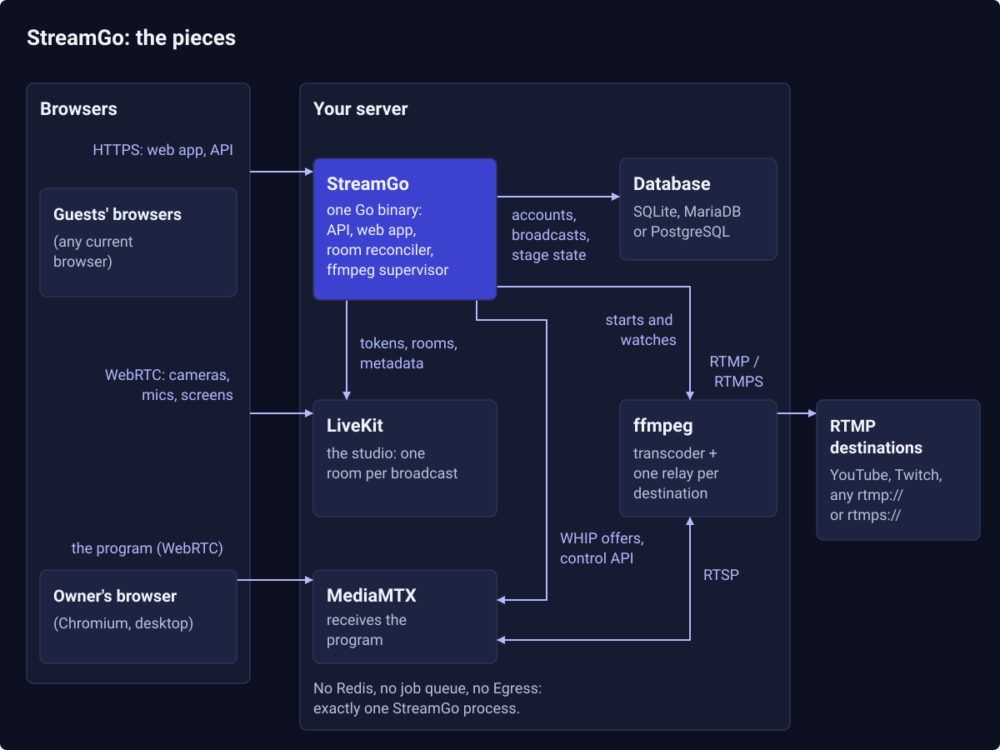

# StreamGo documentation

**StreamGo** is a live-streaming studio that runs on your own server. The host opens a studio in the browser,
invites guests with a link, chooses who is on stage and in which layout, adds a logo and banners, and broadcasts
the result to several RTMP destinations at once (YouTube, Twitch, your own RTMP server). It is one Go binary with
the web app inside, a database (SQLite, MariaDB or PostgreSQL), [LiveKit](https://livekit.io) for the studio
room, [MediaMTX](https://github.com/bluenviron/mediamtx) to receive the program, and ffmpeg to encode it and send
it out.

## Where to start

| I want to… | Read |
|---|---|
| **Install it on Ubuntu or Debian, or on the RHEL family (a package, systemd services)** | [Install from the Linux packages](install-linux.md) |
| Try it in one container | [Install with Docker: the all-in-one image](install-docker.md#the-all-in-one-image) |
| Run it with Docker Compose, on SQLite, MariaDB or PostgreSQL | [Install with Docker](install-docker.md) |
| Install the binary by hand, on any distribution | [Install the binary](install-binary.md) |
| Serve HTTPS from StreamGo itself, self-signed or with my certificate, and know which ports to open | [Standalone HTTPS](standalone-https.md) |
| Put it behind nginx or Caddy | [Behind a reverse proxy](reverse-proxy.md) |
| Configure the Compose stack: ports, addresses behind NAT, backups | [Deployment](deployment.md) |
| Understand how it works inside | [Architecture](architecture.md) |
| Know how it is secured, and what it does not protect | [Security](security.md) |
| See what each release brings | [Changelog](../CHANGELOG.md) |

## Run it your way

| | For | What runs |
|---|---|---|
| **Linux package** | A server without Docker | A `.deb` or `.rpm`: StreamGo, LiveKit and MediaMTX in `/opt/streamgo` as three systemd services, the distribution's ffmpeg |
| **All-in-one image** | One container on one host, a first look | StreamGo, LiveKit, MediaMTX and ffmpeg under supervisord, state in `/data` |
| **Compose stack** | A server with Docker, a checkout of the repository | StreamGo, LiveKit and MediaMTX in containers; SQLite, MariaDB or PostgreSQL |
| **Binary** | Any other distribution with systemd | The files of the packages, laid out by hand |

Every release publishes the `.deb`, the `.rpm`, the `.tar.gz` and their `SHA256SUMS` on
[GitHub](https://github.com/jniltinho/streamgo/releases), and the image as
`ghcr.io/jniltinho/streamgo:<version>-allinone`. All are linux/amd64 only.



What every install needs, whichever way you run it:

- **HTTPS**, except for a browser on the server itself: browsers give a page the camera and the microphone only
  on a secure origin. Either StreamGo serves HTTPS itself ([Standalone HTTPS](standalone-https.md)) or a reverse
  proxy does ([Behind a reverse proxy](reverse-proxy.md)).
- **The media ports open to browsers**: LiveKit's and MediaMTX's WebRTC ports are not HTTP and never go through a
  proxy. There is no TURN server in this version, so a network that allows only web traffic cannot take part.
  The list is in [Standalone HTTPS: ports](standalone-https.md#ports).
- **A desktop Chromium-based browser for the host** (Chrome, Edge, Brave and the like). Guests can use any
  current browser.

## Where it stands

StreamGo is in its first version. This documentation describes the design the project builds to; where a
behaviour was measured rather than only designed, the [architecture guide](architecture.md) says so and gives the
numbers from the [media spike](spike-media-path.md). Two things are known and not yet checked on real hardware: a
host whose browser window is minimized (it passed only in an emulation), and the media ports reached from an
outside network behind NAT. The live output was tested against an RTMP server in the test stack; a long broadcast
to a public platform is part of the manual checks still to run.

Not in this version, so you can plan around it: recordings, more than one StreamGo process, a TURN server, and
composing the program on the server (the broadcast depends on the host's browser staying open; see
[the limits](architecture.md#limits)).

## For developers

StreamGo is Go at the repository root (Cobra, Echo, GORM) with a Vue 3 and TypeScript web app in `frontend/`,
embedded in the binary. Everything builds and tests in Docker; the host needs Docker and `make`. The rules are in
[AGENTS.md](../AGENTS.md), and the plan with its specifications in [`openspec/`](../openspec/).

### Build and run from source

```bash
make init                      # config.toml and .env (secret key and credentials), only when missing
make build                     # dist/streamgo, a static linux/amd64 binary
dist/streamgo version
```

Run the server directly (SQLite under `./data`, an ffmpeg with libx264 on the `PATH`, and a LiveKit and a MediaMTX
to talk to):

```bash
set -a; . ./.env; set +a       # secrets come only from the environment
dist/streamgo server           # http://localhost:8080; GET /healthz and /readyz; applies pending migrations
```

`dist/streamgo --help` lists the commands. Every setting is documented with its default in
[`config.toml.example`](../config.toml.example) and can be overridden by `STREAMGO_<SECTION>_<KEY>`. The secret key,
the database connection string and the LiveKit and MediaMTX credentials are read only from the environment.

### The whole stack

```bash
make up                        # StreamGo, LiveKit and MediaMTX with Docker Compose (DB=sqlite|mariadb|postgres)
make dev                       # the same stack with the Vite dev server in front, on http://localhost:5173
make down                      # stop it (volumes are kept)
```

`make up` advertises the host's network address for media unless `NODE_IP` is set; the published ports come from
`HTTP_PORT`, `LIVEKIT_PORT`, `LIVEKIT_TCP_PORT`, `LIVEKIT_UDP_PORT` and `MEDIAMTX_WEBRTC_PORT`, in the environment
or in `.env`. [Deployment](deployment.md) has the details.

### Check and test

```bash
make check          # gofmt, go vet, golangci-lint (with the layering rule), govulncheck, frontend check and build
make test           # Go tests with -race on SQLite, frontend unit tests
make test-db        # Go tests on SQLite, MariaDB and PostgreSQL, with LiveKit, MediaMTX and ffmpeg (throwaway containers)
make test-package   # build the .deb, .rpm and .tar.gz and install them in clean distribution containers
make test-allinone  # build and smoke test the all-in-one image
```

The studio's browser suite (`frontend/tests/e2e/20-studio.spec.ts`) runs against a running stack; its header says
how. Releases are cut from a tag: the Packages workflow builds and publishes the files, and the image workflow
pushes the all-in-one image.
