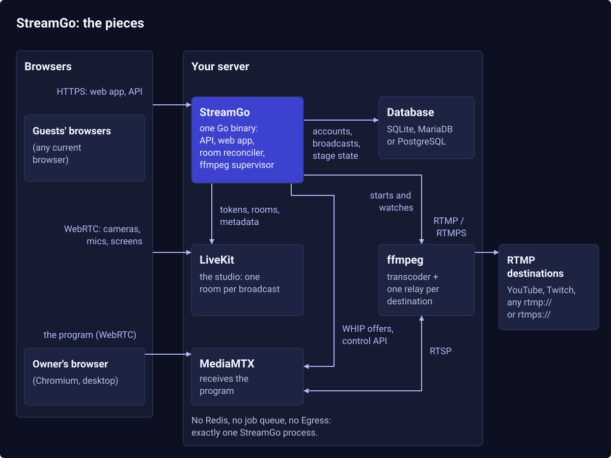
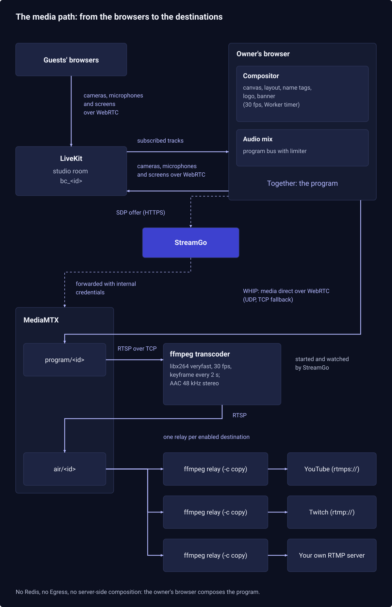
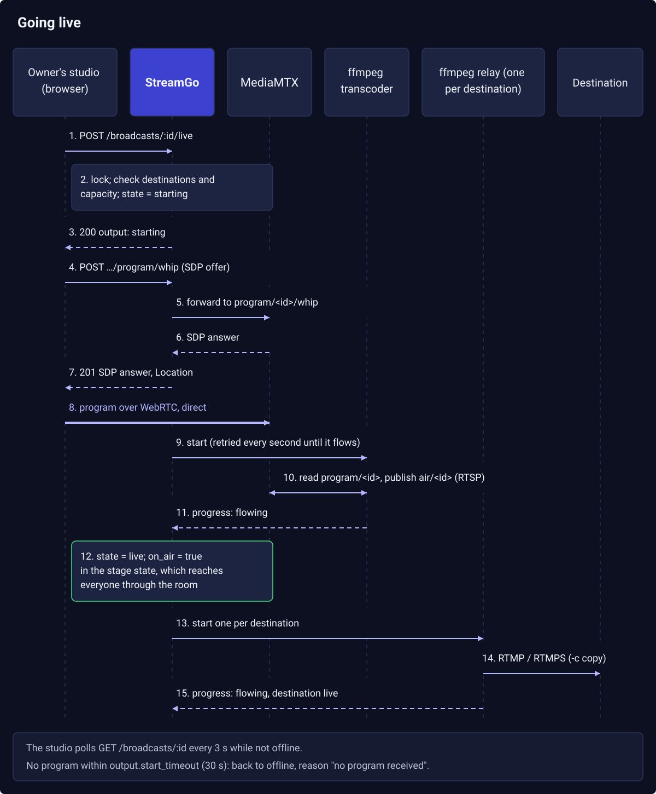
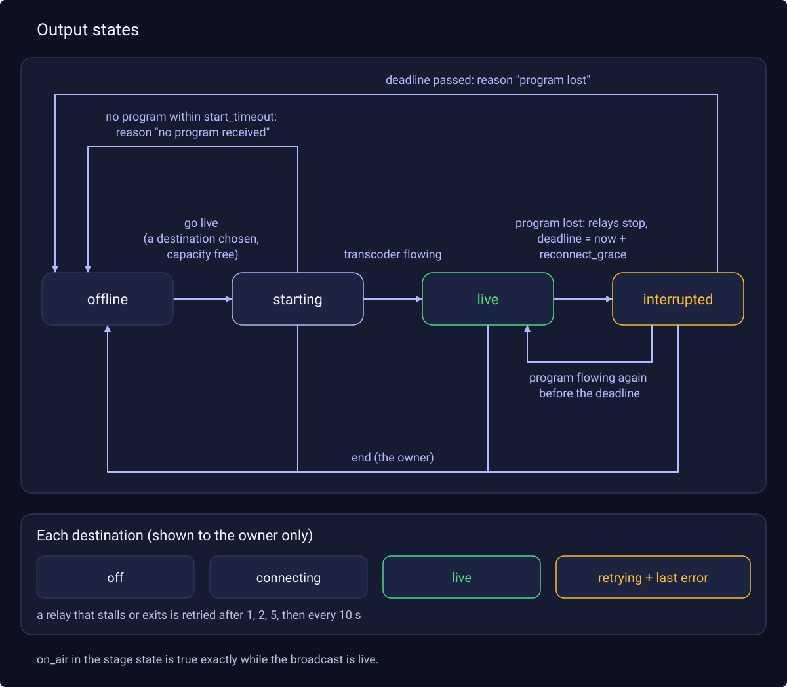

# Architecture

This page explains how StreamGo works inside: which piece owns what, how the stage reaches every participant, how
the picture and sound travel from the browsers to the destinations, what going live does, and what happens when
something breaks. It ends with the limits of this version, stated plainly.



## The pieces and what each owns

| Piece | Owns |
|---|---|
| **StreamGo** (one Go binary) | Accounts and sessions, broadcasts, destinations, guests and invite links, the stage state, LiveKit tokens and rooms, the WHIP endpoint the owner's browser publishes to, and the ffmpeg processes it starts and watches. It serves the web app and the API. |
| **Database** (SQLite, MariaDB or PostgreSQL) | Everything that must survive a restart, the stage state and the output state of each broadcast included. SQLite is the default; the other two are chosen with `database.driver`. |
| **LiveKit** (single node, no Redis) | The studio: one room per broadcast, named `bc_<broadcast id>`, carrying everyone's camera, microphone and screen. |
| **The owner's browser** | The program: it draws the stage on a canvas and mixes the sound, and publishes the result. |
| **MediaMTX** | Receives the program by WebRTC (WHIP) and serves it over RTSP, inside the server, to ffmpeg. |
| **ffmpeg** | One transcoder per live broadcast (H.264 and AAC at a fixed size and rate) and one relay per destination (RTMP or RTMPS, copying without re-encoding). |

There is no Redis, no job queue, no headless Chrome and no LiveKit Egress. The long-running work (supervising
ffmpeg and a reconciliation loop every 15 seconds) runs inside the server and is rebuilt from the database at
startup.

StreamGo does not start LiveKit and MediaMTX itself under `streamgo server`: systemd (the packages), Compose or
supervisord (the all-in-one image) does. `streamgo up` is the exception: it starts the two media servers as child
processes, on loopback ports it chooses at every start, keeps them running and stops them after the server. It is
what the single file runs; see [`streamgo up`](README.md#streamgo-up).

## The stage state and how it reaches everyone

What is on stage is one small JSON document per broadcast:

```json
{ "v": 12, "on_air": true, "layout": "spotlight",
  "sources": [ { "p": "host-01J...", "k": "camera" }, { "p": "guest-01J...", "k": "screen" } ],
  "banner": { "id": "01J...", "text": "Q3 roadmap: what ships next" },
  "logo": "/assets/9f3c....png", "accent": "#3d41cf" }
```

`sources` is ordered, the first being the featured one; `k` is `camera` (camera and microphone) or `screen` (the
screen share and its audio). The layouts are `solo`, `grid`, `spotlight`, `sidebar`, `screen` and `pip`.

**The database is authoritative.** Every change goes through one function in the server, under the broadcast's
lock: it validates the change, increments `v`, commits it to the database, and then copies it into the LiveKit
room's metadata. Every client, owner and guests, renders the stage from that metadata, reading it when it joins
and each time it changes, and drops a document whose `v` is lower than the last one it saw. Tokens never let a
client change the metadata or administer the room.

The commit and the copy cannot be one atomic step, so the guarantee is that the room **converges** to the
database:

- Every route that changes the stage answers with the new stage state, and the owner's studio applies it at once.
  Since the program is drawn in the owner's browser, what goes out follows the API's answer even when the copy to
  the room failed. Guests' previews follow the room and may lag until it is repaired.
- The **room reconciler** runs at startup and every 15 seconds over the rooms named `bc_*`. It deletes a room
  whose broadcast no longer exists, pushes the stored state to a room whose version differs, removes a participant
  who is a removed guest or whom the database does not know, and closes an ingest session still publishing for a
  broadcast that is `offline`.

StreamGo creates each room itself before it issues a token (LiveKit's automatic room creation is off), with the
stored stage state, an empty-room timeout of 300 seconds and the participant limit `studio.max_participants`,
which counts the owner. When the room is full and the owner is not in it, issuing the owner's token removes the
guest who joined last. The owner's identity is `host-<user id>`; opening the studio in a second tab disconnects
the first, which says the studio was opened elsewhere.

## The media path



1. **Studio.** The owner and the guests publish their cameras, microphones and screens to the LiveKit room. Cameras
   are published at 30 fps on every simulcast layer.
2. **Composition, in the owner's browser.** The owner's stage *is* the program canvas, so the preview and the
   output cannot differ. A timer in a Web Worker (not `requestAnimationFrame`, which stops in a hidden tab)
   drives the frames; each source is read through a `MediaStreamTrackProcessor` and the program is emitted through
   a `MediaStreamTrackGenerator` on an exact 30 fps grid. These interfaces exist only in Chromium, which is why
   the host needs a Chromium-based desktop browser. The sound is mixed in one `AudioContext`: every on-stage
   track, the owner's microphone included, goes through a limiter into a program output that exists for the
   whole session, so the program always has an audio track, silent when the stage is empty. Backstage tracks are
   in neither the program nor the speakers.
3. **WHIP through StreamGo.** The browser sends its WebRTC offer to StreamGo
   (`POST /api/v1/broadcasts/:id/program/whip`), which checks that the caller is the owner and that the broadcast
   is going live, forwards the offer to MediaMTX with its internal credentials, and answers with MediaMTX's
   answer. The media itself then flows **directly** from the browser to MediaMTX's WebRTC port, over UDP, or TCP
   as the fallback. A broadcast has one ingest session: a new offer replaces the previous one.
4. **Transcoder.** One ffmpeg per live broadcast reads `program/<id>` from MediaMTX over RTSP, scales it to
   the broadcast's output quality (720p, 1080p or 1440p, see [Output quality](#output-quality)), encodes H.264
   (libx264, `veryfast`, 30 fps constant, a keyframe every 2 seconds, capped bitrate) and AAC (48 kHz stereo), and
   publishes `air/<id>` back to MediaMTX. Whatever size or rate the browser sends, the destinations get the
   broadcast's.
5. **Relays.** One ffmpeg per enabled destination reads `air/<id>` and copies it (`-c copy -f flv`) to the
   destination's `rtmp://` or `rtmps://` address. Starting or stopping one relay does not touch the others.

The exact ffmpeg command lines are in the [media spike](spike-media-path.md#exact-ffmpeg-command-lines-worked).
Measured there, on flat test content with the machine otherwise idle: the transcoder used 28 % of one core at
720p30 and 52 % at 1080p30, a relay under 1 %, and audio and video drifted by about 9 ms over 30 minutes. With
the owner's tab hidden for five minutes, every second still had at least 28 fresh pictures per participant.
`output.max_concurrent` (default 2) limits how many broadcasts transcode at once.

### How StreamGo knows ffmpeg is working

A running process is not a working one, so StreamGo reads ffmpeg's machine-readable progress and reports three
things:

- **started**: the process exists;
- **flowing**: the output's media time advances. The transcoder flowing is what makes a broadcast `live`; a relay
  flowing is what makes a destination `live`;
- **stalled or exited**: the media time did not advance for 5 seconds (the process is killed), or the process
  ended. Any exit during a run counts as a loss, since ffmpeg exits with code 0 when its input goes away.

Progress means ffmpeg wrote the data, not that the far end received it: a destination that stops reading is
noticed when the socket buffers fill, and then the 5-second watchdog fires, so a stalled destination shows
`retrying` within 15 seconds.

ffmpeg runs without a shell, with a minimal environment that holds none of StreamGo's secrets, in its own process
group, and dies with the server even when the server is killed. At startup StreamGo checks that the configured
ffmpeg has the encoders, decoders, formats, protocols and filters the two command lines need, and refuses to start
otherwise.

### Output quality

Each broadcast has its own resolution, chosen by its owner in the studio's Destinations tab while it is offline;
a new one starts at `output.resolution` and none goes above `output.max_resolution` (a broadcast stored above a
ceiling lowered later goes out at the ceiling). The ladder, in `internal/core/broadcast/profile.go`, is the one
place that spells a size: 720p 1280x720 at 4000 kbit/s, 1080p 1920x1080 at 6000, 1440p 2560x1440 at 12000;
`output.video_bitrate_kbps` replaces the bitrate of all three when it is not 0. The broadcast detail gives the
studio its program size and bitrate: the canvas is drawn at that size, a shared screen is captured at up to it,
and the WHIP sender's ceiling is twice the bitrate. The resolution is read when the transcoder starts and cannot
change until the broadcast is offline again, so a run has one size from start to end.

What ships was measured first (task 1.1 of `add-output-quality`), on the development machine (24 threads, ffmpeg
8.0.1) with **headless** Chrome, which has no GPU: an owner and a guest with Chrome's fake 720p cameras and a
shared screen at the program's size (a page of text scrolling at 30 fps) on stage, live to a test RTMP
destination, 20 s recorded there.

| Program | Compositor tick (mean / p95 / max) | Ticks/s | WHIP sender | Distinct frames received | Keyframes | StreamGo container CPU |
|---|---|---|---|---|---|---|
| 1080p, 6000 kbit/s | 8.0 / 9.8 / 13.3 ms | 30.0 | 1920x1080, 30.0 fps, 9.3 Mbit/s | 555 of 555 (30 fps) | every 60 | 0.7 to 0.8 core |
| 1440p, 12000 kbit/s | 11.1 / 14.6 / 21.1 ms | 30.0 | 2560x1440, 30.0 fps, 10.6 Mbit/s | 556 of 558 (30 fps) | every 60 | 1.4 to 1.5 cores |
| 2160p, 20000 kbit/s | not measurable | – | – | 30 to 40 of 471 to 575 (1.5 to 2 fps) | every 60 | – |

At 2160p the owner's page could not keep up: going live took 48 s instead of about one, the page stopped
answering for more than 15 s at a time, the destination got 30 to 40 distinct pictures in 20 s (the transcoder
repeats the last picture to keep 30 fps constant, so only the distinct ones count), and the program was then lost.
With Chrome's own fake screen capture instead of the scrolling page the broadcast did not even reach live within
60 s. 2160p is therefore left out. A desktop Chrome with a GPU may do better; it was not measured. The
transcoder's own command line on a synthetic picture, measured before (one core is 100 %): 0.5 core at 1080p, 0.9
at 1440p, 2.3 at 2160p.

## Going live



`POST /api/v1/broadcasts/:id/live` moves an `offline` broadcast to `starting` when it has at least one chosen
destination, none of them is in use by another broadcast, and the server is under `output.max_concurrent`;
otherwise it answers 409 saying why. Then the studio publishes the program by WHIP, and StreamGo starts the
transcoder, retrying it every second until it flows (an ffmpeg whose input path does not exist yet exits at
once). When the transcoder flows, the broadcast becomes `live`, `on_air` becomes true in the stage state (so every
participant's studio shows it), and one relay starts per destination. If no program arrives within
`output.start_timeout` (30 seconds by default), the broadcast goes back to `offline` with the reason
`no program received`. While a broadcast is not `offline`, the owner's studio asks for its state every 3 seconds.

### Output states



| State | Meaning |
|---|---|
| `offline` | Nothing runs. After a run, the reason says how it ended, unless the owner ended it. |
| `starting` | Going live was accepted; waiting for the transcoder to flow. |
| `live` | The transcoder is flowing; relays run for every chosen destination. |
| `interrupted` | The program stopped arriving; relays are stopped; a deadline is stored. |

Each destination has its own status, shown only to the owner: `off`, `connecting`, `live`, or `retrying` with the
last error. A relay that stalls or exits while the broadcast is live is retried after 1, 2 and 5 seconds and then
every 10 seconds, without touching the other destinations. Destinations can be added and removed while live;
removing the last one is refused.

Everything that changes a broadcast (stage writes, going live, ending, the WHIP requests, destination changes and
ffmpeg's events) runs under one lock per broadcast. Each go-live starts a **run** with a number stored in the
broadcast, and every process, timer, ingest session and event carries it: an event from an earlier run is ignored,
so a late message from a run that was ended cannot revive the broadcast. While a broadcast is not `offline`, the
address and key of its chosen destinations cannot be edited, the destinations cannot be deleted, and no other
broadcast can use them.

**Ending** (`DELETE /api/v1/broadcasts/:id/live`) stops the relays and the transcoder (5 seconds each before they
are killed), closes the ingest session, sets `on_air` to false and returns the broadcast to `offline`, from any
state.

## Interruption and resumption

When the program stops arriving during a live broadcast (the owner's browser closed, crashed or lost the network),
the broadcast becomes `interrupted`, the relays stop, and a deadline of `output.reconnect_grace` (2 minutes by
default) is stored. If the program flows again before the deadline, the broadcast becomes `live` with the same
destinations; otherwise it returns to `offline` with the reason `program lost`. The transcoder restarts on
resumption, which resets the timestamps the destinations see.

A reloaded studio reconnects to the room by itself, but a new page cannot play or capture sound until someone
clicks, and an offer made before that would lose its audio for good. So after a reload during a live or
interrupted broadcast the studio shows one **Resume broadcast** action and publishes on that click. A screen
share always needs a new gesture and must be shared again.

## What a restart does

Stopping StreamGo is not ending a broadcast: it stops the ffmpeg processes and leaves the stored state alone. At
the next start:

- a broadcast stored as `starting` or `live` becomes `interrupted` with a new deadline;
- one stored as `interrupted` keeps the deadline it had, so repeated restarts cannot extend an outage;
- the transcoder loop resumes those whose program is still being published, and they become `live` again;
- the room reconciler runs at once and brings every room back in line with the database.

The ingest session's address is stored, so ending a broadcast after a restart still closes the ingest opened
before it. ffmpeg processes die with the server even when it is killed with `SIGKILL`.

## Code layout and the core rule

```
main.go                      cmd.Execute()
cmd/                         the commands (server, migrate, user, healthcheck, version): the composition root
internal/core/               the domain; imports only the standard library, x/crypto and each other
  account/                   users, password hashing, sessions
  broadcast/                 broadcasts, invite link, ownership, the per-broadcast lock
  stage/                     stage state, validation, the single writer
  studio/                    joining, guests, removal, the room reconciler
  destination/               destinations and their selection
  output/                    the output state machine and its orchestration
internal/store/              GORM repositories and the migrations for each database
internal/livekit/            tokens, rooms, metadata, participants (LiveKit server SDK)
internal/mediamtx/           the WHIP client and MediaMTX's control API
internal/ffmpeg/             the process supervisor: progress, watchdog, arguments, redaction, capability check
internal/httpserver/         the router, middleware and thin handlers
internal/config/ sealed/ ratelimit/ theme/ buildinfo/
web/                         embeds the built web app
frontend/                    the Vue 3 web app; frontend/src/core holds the layout, compositor, audio mix and WHIP client
deployments/compose/         the Compose stack
```

**The core rule.** `internal/core/...` must not import Echo, GORM, a database driver, the LiveKit SDK, `os/exec`
or `net/http`. It defines small interfaces (ports) for rooms, processes, ingest and the clock, and the adapters
under `internal/` implement them. The output state machine is therefore pure: it takes events (`GoLive`,
`TranscoderFlowing`, `ProgramLost`, `End`, …) and returns the new state and commands (`StartTranscoder`,
`StartRelay`, `SetOnAir`, …), and it is tested with a fake clock and no process. A lint rule fails the build when
the core imports something it must not; another keeps `vue`, `pinia` and `vue-router` out of
`frontend/src/core`.

## Limits

These are the limits of this version. None of them is hidden from the people using it.

- **One instance.** A deployment runs exactly one StreamGo process, enforced by a lock file in the data
  directory. This holds with MariaDB or PostgreSQL too: each process would supervise its own ffmpeg for the same
  broadcast. Two servers on one database with different data directories are not detected and are not supported.
- **The broadcast depends on the owner's browser.** The program is composed there. If the browser closes or loses
  the network for longer than `output.reconnect_grace`, the broadcast ends. A reload needs one click to resume the
  sound, and a screen share must be shared again. The owner's machine and upload speed limit the quality; WebRTC
  lowers the resolution under congestion, and the transcoder keeps the output at the broadcast's size. 1440p asks
  the owner's upload for up to 24 Mbit/s and the server for about two cores per live broadcast; output above 1440p
  is not offered (see [Output quality](#output-quality)).
- **A minimized window is not proven.** A hidden tab was measured and passed; a minimized window passed only in an
  emulation and is checked on a real desktop before the release. The studio warns while its tab is hidden.
- **No TURN.** The owner's browser must reach MediaMTX's WebRTC port over UDP, or at least TCP, and guests must
  reach LiveKit's media ports. A network that allows only web traffic through a proxy cannot take part.
- **Backstage is not private between participants.** Backstage tracks are kept out of the program and out of
  normal playback, but a participant with a modified client could still subscribe to another participant's tracks
  in the same studio.
- **A removed guest can reconnect for a few seconds at a time** while a token they hold is still valid; the
  reconciler removes them again within 15 seconds, and they are never in the program. See
  [Security](security.md#guests-and-invite-links).
- **A destination's address and key are an argument of its relay process**, visible to other processes of the
  same user or container. See [Security](security.md#process-arguments).
