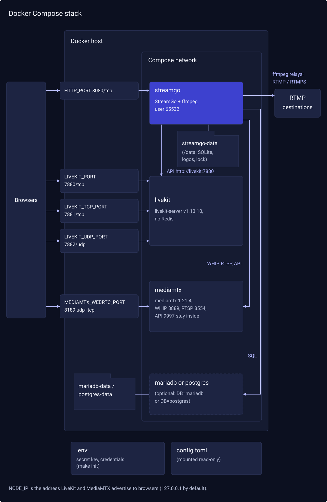

# Install with Docker

This guide runs StreamGo with Docker Compose from a checkout of the repository: StreamGo, LiveKit and MediaMTX in
containers on one host, with SQLite by default or MariaDB or PostgreSQL. It takes you from a clean checkout to
the first user signed in, then covers the ports, the database, upgrading, backups and stopping. The details of
the stack (advertised addresses behind NAT, HTTPS in front of it) are in the [deployment guide](deployment.md).
For one container without a checkout, see [the all-in-one image](#the-all-in-one-image) at the end.



## What you need

- A linux/amd64 host with Docker (with the Compose plugin), `make` and `git`. The image is built on the host from
  the checkout; nothing else is installed.
- For anything but a browser on the same machine: HTTPS ([Standalone HTTPS](standalone-https.md) or
  [a reverse proxy](reverse-proxy.md)) and the media ports reachable by browsers (see [Ports](#ports)).

## 1. Get the code and create the settings

```bash
git clone https://github.com/jniltinho/streamgo.git
```

```bash
cd streamgo
```

```bash
make init
```

`make init` creates two files, and only when they do not exist:

| File | What it holds |
|---|---|
| `config.toml` | The settings, copied from `config.toml.example`, which documents each one with its default. The stack mounts it read-only. |
| `.env` | The secrets, readable only by you: `STREAMGO_SECRET_KEY` (seals stream keys and invite links), the LiveKit API key and secret, the MediaMTX user and password, and a database password. |

`make init` never replaces an existing file or value: a new secret key would make every stored destination and
invite link unreadable. Keep `.env` with your backups (see [Backup](#backup)).

## 2. Choose the ports (optional)

The stack publishes the standard ports (8080, 7880, 7881, 7882/udp and 8189). When one of them is taken on the
host, or to keep this stack apart from another, set other numbers and a project name in `.env`. For example:

```bash
cat >> .env <<'EOF'
COMPOSE_PROJECT_NAME=streamgo-w
HTTP_PORT=38080
LIVEKIT_PORT=37880
LIVEKIT_TCP_PORT=37881
LIVEKIT_UDP_PORT=37882
MEDIAMTX_WEBRTC_PORT=38189
EOF
```

Values in `.env` apply to every `make` target and Compose command of this checkout. The same variables can also be
given in the shell for one command (`HTTP_PORT=38080 make up`), but then they must be repeated for `make down` and
`make logs`. The [Ports](#ports) section says what each one is.

## 3. Start the stack

```bash
make up
```

The first run builds the image (the web app, the binary and Alpine's ffmpeg), so it takes a few minutes. `make up`
waits until the containers are healthy and prints the address, for example
`StreamGo is up: http://localhost:38080`. The server applies the database migrations by itself at startup.

To check it from the command line (use your `HTTP_PORT`):

```bash
curl http://localhost:8080/readyz
```

It answers `{"checks":{"database":"ok","livekit":"ok"},"status":"ready"}` when the database and LiveKit answer,
and 503 naming the failing check otherwise. `/healthz` answers as long as the process runs.

## 4. Create the first user

Accounts are created from the command line; there is no sign-up page. Use your project name after `-p`
(`streamgo` unless you set `COMPOSE_PROJECT_NAME`):

```bash
docker compose -p streamgo exec streamgo streamgo user add --email you@example.com --name "Your Name"
```

It asks for the password twice. To pass it on standard input instead (from a password manager or a script), add
`-T` after `exec` and `--password-stdin` at the end, and pipe the password in.

This first account is the administrator: once signed in, it creates the other accounts on the **Users** page of
the web app, so the command line is only needed for this one.

## 5. Sign in

Open the address `make up` printed, for example `http://localhost:8080`, in a browser **on the same machine**, and
sign in with the e-mail and password you just set. On `localhost` the browser allows the camera and the microphone
without HTTPS; from any other machine you need HTTPS first ([Standalone HTTPS](standalone-https.md) or
[a reverse proxy](reverse-proxy.md)) and `NODE_IP` set to the server's address
([deployment guide](deployment.md#advertised-addresses-behind-nat)).

Hosting the studio needs a desktop Chromium-based browser (Chrome, Edge, Brave and the like); guests can use any
current browser.

The other user commands (`list`, `passwd`, `disable`, `enable`) run the same way:

```bash
docker compose -p streamgo exec streamgo streamgo user --help
```

## Ports

Only these ports are published, each set by a variable in `.env` or the shell:

| Variable | Default | Protocol | What | Reached by |
|---|---|---|---|---|
| `HTTP_PORT` | 8080 | TCP | the app and the API, plain HTTP | browsers, or your reverse proxy |
| `LIVEKIT_PORT` | 7880 | TCP | LiveKit's signalling (WebSocket) | browsers, or your reverse proxy |
| `LIVEKIT_TCP_PORT` | 7881 | TCP | LiveKit's media over TCP | browsers |
| `LIVEKIT_UDP_PORT` | 7882 | UDP | LiveKit's media over UDP | browsers |
| `MEDIAMTX_WEBRTC_PORT` | 8189 | UDP and TCP | MediaMTX's WebRTC media: the owner's program | the owner's browser |
| `DEV_PORT` | 5173 | TCP | the Vite dev server, `make dev` only | developers |

The media ports are published on the same number inside and outside the containers, because LiveKit and MediaMTX
put them in the addresses they give browsers. MediaMTX's WHIP (8889), RTSP (8554) and control API (9997) listeners
are never published; only StreamGo and its ffmpeg reach them, on the Compose network.

To publish a port on one address only, put the address in the variable, for example
`HTTP_PORT=127.0.0.1:8080` when a reverse proxy on the same host is the only client. Do that only for
`HTTP_PORT` and `LIVEKIT_PORT`: the media ports must stay plain numbers, since the same value is also given to
LiveKit and MediaMTX as the port to listen on. With an address in `HTTP_PORT` or `LIVEKIT_PORT`, also set
`STREAMGO_SERVER_PUBLIC_URL` and `STREAMGO_LIVEKIT_URL` in `.env`, since their defaults are built from the
port variables.

To change a port on a running stack, edit `.env` and run `make up` again; Compose recreates the containers whose
settings changed.

## Choosing the database

SQLite is the default and needs nothing else: the database lives in the `streamgo-data` volume. For MariaDB or
PostgreSQL, add `DB=` to every `make` command of the stack:

```bash
make up DB=postgres
```

```bash
make down DB=postgres
```

`DB` is `sqlite`, `mariadb` or `postgres`. The database runs in a container of the stack with its own volume
(`mariadb-data` or `postgres-data`) and the password from `STREAMGO_DATABASE_PASSWORD` in `.env`; it publishes no
port. Choose the database before you create data: switching later starts from an empty database, and there is no
tool to move data between them.

## Settings

`config.toml` holds the settings, each documented with its default in `config.toml.example`. Any setting can also
be given as an environment variable named `STREAMGO_<SECTION>_<KEY>` in `.env`, for example:

```bash
echo 'STREAMGO_OUTPUT_RESOLUTION=1080p' >> .env
```

```bash
make up
```

The stack sets some of them itself: the public URL (`STREAMGO_SERVER_PUBLIC_URL`, by default
`http://localhost:<HTTP_PORT>`), the LiveKit URL browsers use (`STREAMGO_LIVEKIT_URL`, by default
`ws://localhost:<LIVEKIT_PORT>`), and the internal addresses of LiveKit and MediaMTX. Set the first two in `.env`
for a real install; the [deployment guide](deployment.md#https-and-secure-websocket) and the
[reverse proxy guide](reverse-proxy.md) show the values.

## Logs

```bash
make logs
```

It follows StreamGo's log. Each request is logged with its route pattern (`/api/v1/join/:token`), never the raw
path, so invite tokens do not reach the log.

## Upgrading

Back up first ([Backup](#backup)), then update the checkout and start the stack again:

```bash
git pull
```

```bash
make init
```

```bash
make up
```

`make init` adds any variable a newer version needs to `.env` and changes nothing else. `make up` rebuilds the
image and recreates the containers; StreamGo applies new database migrations at startup. Upgrading stops the
server, so do it while nothing is live: a broadcast that was live comes back as `interrupted` and resumes only if
the owner's browser is still publishing ([what a restart does](architecture.md#what-a-restart-does)).

## Backup

Three things belong together: the database, the assets directory (uploaded logos) and the secret key in `.env`.
A database restored without its key keeps the accounts but cannot open the stream keys or the invite links. The
commands to back up and restore the volume, for SQLite and for the other two databases, are in the
[deployment guide](deployment.md#backup-and-restore); remember that the volume's name starts with your project
name (`streamgo_streamgo-data`, or `streamgo-w_streamgo-data` with the example above).

## Stopping and removing

```bash
make down
```

stops the stack and keeps its volumes: `make up` brings it back with its data.

```bash
make down V=1
```

stops the stack and **deletes its volumes**: the database, the logos and everything in them. `.env` and
`config.toml` stay in the checkout; delete them too only if you do not need the data again.

## The all-in-one image

One container with StreamGo, LiveKit, MediaMTX and Alpine's ffmpeg under supervisord, for a single host. It runs
as a non-root user (uid 65532), keeps everything in `/data` (SQLite, logos, the secrets), and needs no checkout.
LiveKit's signalling stays inside the container: browsers reach it through StreamGo at `/livekit/`.

The image is published as `ghcr.io/jniltinho/streamgo` with these tags:

| Tag | What |
|---|---|
| `X.Y.Z-allinone`, for example `0.1.0-allinone` | That release |
| `X.Y-allinone` | The latest release of that minor version |
| `allinone` | The latest release |
| `main-allinone` | The current state of the `main` branch, not a release |

Start it, with `NODE_IP` set to the address browsers reach the server at (its public address behind NAT):

```bash
docker run -d --name streamgo --restart unless-stopped --stop-timeout 50 -v streamgo-data:/data -p 8080:8080 -p 7881:7881 -p 7882:7882/udp -p 8189:8189 -p 8189:8189/udp -e NODE_IP=203.0.113.10 ghcr.io/jniltinho/streamgo:0.1.0-allinone
```

On the first start the container creates the secret key and the credentials the three services share in
`/data/streamgo.env`, and never replaces them afterwards. `docker ps` shows the container as `healthy` once
`/readyz` answers.

Create the first user; it asks for the password twice:

```bash
docker exec -it streamgo streamgo user add --email you@example.com --name "Your Name"
```

Then sign in at `http://<server>:8080`. This first account is the administrator; it creates the others on the
**Users** page.

| | |
|---|---|
| Ports | 8080/tcp (the app, the API and `/livekit/`), 7881/tcp and 7882/udp (LiveKit's media), 8189/udp and 8189/tcp (MediaMTX's media). Publish the media ports on the **same numbers**: LiveKit and MediaMTX give browsers those numbers. The app's port may differ, but then set `STREAMGO_SERVER_PUBLIC_URL` to match (for example `-p 38080:8080 -e STREAMGO_SERVER_PUBLIC_URL=http://localhost:38080`), or every sign-in is refused by the origin check. |
| `NODE_IP` | The address LiveKit and MediaMTX advertise for media; `make up` uses the host's network address unless this is set. The all-in-one image and a plain `docker compose up` use `127.0.0.1`, which only serves a browser on the same machine (Firefox only after the site was allowed to use the camera). |
| Settings | Any `STREAMGO_<SECTION>_<KEY>` given with `-e` (a value given to the container wins over `/data/streamgo.env`). |
| HTTPS | `-e STREAMGO_SERVER_SELF_SIGNED=true -e STREAMGO_SERVER_PUBLIC_URL=https://studio.example.com:8080`, see [Standalone HTTPS](standalone-https.md), or a reverse proxy in front of 8080 ([Behind a reverse proxy](reverse-proxy.md)). |
| Logs | `docker logs -f streamgo` (the three services) |
| Services | `docker exec streamgo supervisorctl status` |
| Backup | Stop the container and copy the `streamgo-data` volume: it holds the database, the logos and the secret key together. |
| Upgrade | Pull the new tag, remove the container and start a new one on the same volume. |

A host directory instead of a named volume must belong to uid 65532 (`chown -R 65532:65532 <dir>`); otherwise the
container stops at once saying `/data` is not writable.

To build the image from a checkout instead: `make image-allinone` tags it `streamgo:<version>-allinone` and
`streamgo:allinone`.
