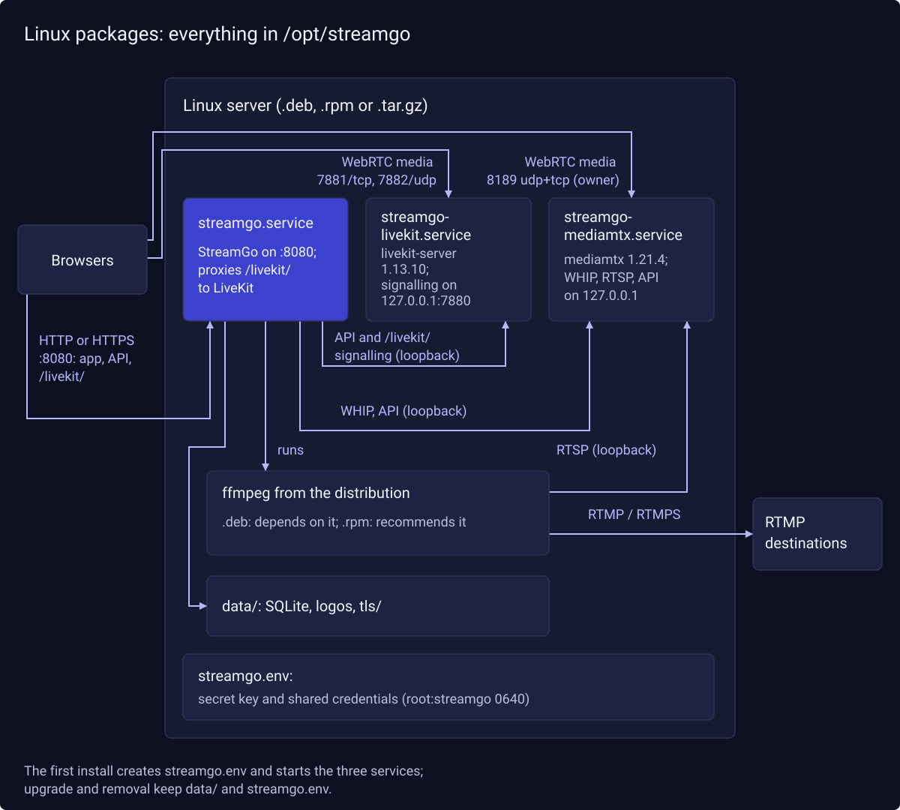

# Install from the Linux packages

This guide installs StreamGo on a server from the `.deb` package, on Ubuntu 26.04 or Debian 13, and covers the
`.rpm` for the RHEL family at the end. The package puts StreamGo and the two media servers it needs, LiveKit and
MediaMTX, under `/opt/streamgo` as three systemd services, generates their secrets, and starts them. The program is
encoded with the distribution's ffmpeg.

The packages are built for linux/amd64 only. To install the same files by hand on another distribution, see
[Install the binary](install-binary.md); to run StreamGo in Docker, see [Install with Docker](install-docker.md).



## 1. Download and verify

Each release on GitHub carries four files: the `.deb`, the `.rpm`, the `.tar.gz` and `SHA256SUMS`. Download the
`.deb` and the checksums of the version you want (here 0.2.0):

```bash
curl -LO https://github.com/jniltinho/streamgo/releases/download/v0.2.0/streamgo_0.2.0_amd64.deb
```

```bash
curl -LO https://github.com/jniltinho/streamgo/releases/download/v0.2.0/SHA256SUMS
```

```bash
sha256sum --check --ignore-missing SHA256SUMS
```

The last command must print `streamgo_0.2.0_amd64.deb: OK`. Anything else means the file is damaged or not the
one published: do not install it.

## 2. Install

```bash
sudo apt install ./streamgo_0.2.0_amd64.deb
```

The `./` matters: it tells apt to install the file, not to look for a package of that name. apt also installs the
distribution's `ffmpeg`, which the package depends on.

## 3. What is running

A fresh install creates the `streamgo` system user, generates the secrets, and enables and starts three services:

| Service | Runs | Listens on |
|---|---|---|
| `streamgo.service` | `/opt/streamgo/bin/streamgo server`: the app, the API, and LiveKit's signalling at `/livekit/` | `:8080`, every interface |
| `streamgo-livekit.service` | `/opt/streamgo/bin/livekit-server`: the studio rooms | signalling on 127.0.0.1:7880; media on 7881/tcp and 7882/udp |
| `streamgo-mediamtx.service` | `/opt/streamgo/bin/mediamtx`: receives the program | WHIP 8889, RTSP 8554 and API 9997 on 127.0.0.1; media on 8189/udp and 8189/tcp |

All three run as the `streamgo` user. Check them:

```bash
systemctl status streamgo streamgo-livekit streamgo-mediamtx
```

```bash
curl http://localhost:8080/readyz
```

`/readyz` answers `{"checks":{"database":"ok","livekit":"ok","mediamtx":"ok"},"status":"ready"}` when the
database, LiveKit and MediaMTX all answer. The logs are in the journal:

```bash
journalctl -u streamgo -f
```

Everything the package installs is under `/opt/streamgo`:

| Path | What | Owner and mode |
|---|---|---|
| `bin/streamgo`, `bin/livekit-server`, `bin/mediamtx`, `bin/init-env` | The programs (LiveKit 1.13.10 and MediaMTX 1.21.4) | root, 0755 |
| `config.toml` | StreamGo's settings | root, 0644, kept on upgrade |
| `livekit.yaml`, `mediamtx.yml` | The media servers' settings | root, 0644, kept on upgrade |
| `streamgo.env` | The secrets: the secret key and the credentials the three services share | root:streamgo, 0640, never replaced or removed by the package |
| `streamgo.env.example` | The commented template of `streamgo.env` | root, 0644 |
| `data/` | The SQLite database, uploaded logos, the instance lock, the self-signed certificate | streamgo:streamgo, 0750 |
| `LICENSE`, `NOTICE`, `THIRD_PARTY` | Licences, those of LiveKit and MediaMTX included | root, 0644 |

The units are in `/usr/lib/systemd/system/`.

## 4. Create the first user

Accounts are created from the command line; there is no sign-up page. The command reads the secrets from
`streamgo.env` and runs as the `streamgo` user, so the database keeps its owner. Become root:

```bash
sudo -i
```

then create the account; it asks for the password twice:

```bash
cd /opt/streamgo && set -a && . ./streamgo.env && set +a && setpriv --reuid streamgo --regid streamgo --init-groups ./bin/streamgo user add --email you@example.com --name "Your Name"
```

```bash
exit
```

The first account of an install is its administrator. Once signed in, the administrator creates the other
accounts, changes their role or password, and disables or enables them on the **Users** page of the web app; the
command line is only needed for this first one. The same way as above, `./bin/streamgo user list`, `user passwd`,
`user disable`, `user enable` and `user admin <email> [--revoke]` manage accounts from the server.

Open `http://<server>:8080` and sign in. From any machine other than the server itself, the browser allows the
camera and the microphone only over HTTPS: set it up first ([section 6](#6-https)).

## 5. Open the ports

Browsers must reach these ports on the server:

| Port | Protocol | What |
|---|---|---|
| 8080 | TCP | The app, the API and LiveKit's signalling (`/livekit/`) |
| 7881 | TCP | LiveKit's media over TCP |
| 7882 | UDP | LiveKit's media over UDP |
| 8189 | UDP and TCP | MediaMTX's media: the owner's program |

With ufw:

```bash
sudo ufw allow 8080/tcp
```

```bash
sudo ufw allow 7881/tcp
```

```bash
sudo ufw allow 7882/udp
```

```bash
sudo ufw allow 8189
```

Port 7880 (LiveKit's signalling) and MediaMTX's 8889, 8554 and 9997 listen on the loopback address only and must
not be opened. There is no TURN server, so a network that blocks these ports cannot take part; see
[Standalone HTTPS: ports](standalone-https.md#ports) for the whole list.

**Behind NAT** (a cloud server with a private address, or a router forwarding the ports), both media servers must
tell browsers the public address. In `/opt/streamgo/livekit.yaml`, add under `rtc:`:

```yaml
rtc:
  node_ip: 203.0.113.10
```

and in `/opt/streamgo/mediamtx.yml` set:

```yaml
webrtcAdditionalHosts: [203.0.113.10]
```

then restart them, and forward the four media ports on the same numbers:

```bash
sudo systemctl restart streamgo-livekit streamgo-mediamtx
```

## 6. HTTPS

Browsers need HTTPS for the camera and the microphone. Choose one way:

- **StreamGo's own HTTPS, self-signed**, the quickest: add two lines to `/opt/streamgo/streamgo.env` (use the
  name or address people type):

  ```bash
  echo 'STREAMGO_SERVER_SELF_SIGNED=true' | sudo tee -a /opt/streamgo/streamgo.env
  ```

  ```bash
  echo 'STREAMGO_SERVER_PUBLIC_URL=https://studio.example.com:8080' | sudo tee -a /opt/streamgo/streamgo.env
  ```

  ```bash
  sudo systemctl restart streamgo
  ```

  StreamGo now speaks HTTPS on port 8080 with a certificate it generated in
  `/opt/streamgo/data/tls/selfsigned.crt`, and LiveKit's signalling works over the same port at `/livekit/`.
  Browsers warn once per device, guests included. A certificate of your own, the fingerprint and what guests see
  are in [Standalone HTTPS](standalone-https.md).
- **A reverse proxy** (nginx or Caddy) with a public certificate on port 443: see
  [Behind a reverse proxy](reverse-proxy.md). Then set `addr = "127.0.0.1:8080"` in `config.toml`, so only the
  proxy reaches StreamGo, and close 8080 in the firewall.

## 7. Configuration

| File | What | After a change |
|---|---|---|
| `/opt/streamgo/config.toml` | StreamGo's settings, each documented with its default | `sudo systemctl restart streamgo` |
| `/opt/streamgo/streamgo.env` | The secrets, and any setting as `STREAMGO_<SECTION>_<KEY>=value`; a value here wins over `config.toml` | `sudo systemctl restart streamgo-livekit streamgo-mediamtx streamgo` |
| `/opt/streamgo/livekit.yaml` | LiveKit: ports, advertised address | `sudo systemctl restart streamgo-livekit` |
| `/opt/streamgo/mediamtx.yml` | MediaMTX: the media port, advertised address | `sudo systemctl restart streamgo-mediamtx` |

Secrets go only in `streamgo.env`: StreamGo refuses them in `config.toml`. In `streamgo.env`, write one
`NAME=value` per line, without `export`, and put a value in single quotes when it holds anything but letters,
digits and `+ - _ . / : @ =`.

The packaged `config.toml` differs from `config.toml.example` in a few lines: the data directory is `/opt/streamgo/data`,
`livekit.url` is empty (browsers reach LiveKit through `/livekit/`), and LiveKit and MediaMTX are reached on
127.0.0.1.

For MariaDB or PostgreSQL instead of SQLite, set `driver` under `[database]` in `config.toml` and the connection
string as `STREAMGO_DATABASE_DSN` in `streamgo.env`.

## 8. Upgrade

Back up first ([section 9](#9-backup)), download and verify the new `.deb` as in section 1, then:

```bash
sudo apt install ./streamgo_0.3.0_amd64.deb
```

The upgrade keeps `config.toml`, `livekit.yaml`, `mediamtx.yml`, `streamgo.env` and `data/`, and restarts the
services that were running. If you edited one of the three configuration files and the new version changes it
too, apt asks which one to keep. StreamGo applies new database migrations when it starts. A broadcast live during
the upgrade comes back as `interrupted` and resumes only if the owner's browser is still publishing.

## 9. Backup

Three things belong together: `data/` (the database and the logos), `streamgo.env` (the secret key) and your
configuration. A database restored without its key keeps the accounts but cannot open the stream keys and invite
links. Stop StreamGo for a consistent copy:

```bash
sudo systemctl stop streamgo
```

```bash
sudo tar czf streamgo-backup.tgz -C /opt/streamgo data streamgo.env config.toml livekit.yaml mediamtx.yml
```

```bash
sudo systemctl start streamgo
```

Keep the archive as private as the key deserves. To restore, install the package, stop the three services, unpack
the archive into `/opt/streamgo`, and start them again. With MariaDB or PostgreSQL, dump the database with its own
tools as well.

## 10. Remove

```bash
sudo apt remove streamgo
```

stops and disables the services and removes the programs and units. `sudo apt purge streamgo` also removes
`config.toml`, `livekit.yaml` and `mediamtx.yml`. Neither touches `/opt/streamgo/data`, `/opt/streamgo/streamgo.env`
or the `streamgo` user: installing the package again finds the same data and key. To delete everything, after a
purge:

```bash
sudo rm -rf /opt/streamgo
```

```bash
sudo userdel streamgo
```

## The `.rpm`: AlmaLinux, Rocky Linux and the RHEL family

The `.rpm` holds the same files and services. Download and verify it as in section 1
(`streamgo-0.2.0-1.x86_64.rpm`), then:

```bash
sudo dnf install ./streamgo-0.2.0-1.x86_64.rpm
```

The `.rpm` does not depend on ffmpeg, it only recommends `(ffmpeg or ffmpeg-free)`: the RHEL family has no ffmpeg
with libx264 in its own repositories, and EPEL's `ffmpeg-free` lacks libx264. Without libx264, StreamGo refuses to
start and its log names what is missing. Install RPM Fusion's ffmpeg (it needs EPEL and the CRB repository):

```bash
sudo dnf install epel-release
```

```bash
sudo dnf install https://mirrors.rpmfusion.org/free/el/rpmfusion-free-release-$(rpm -E %rhel).noarch.rpm
```

If `ffmpeg-free` is already installed, swap it:

```bash
sudo dnf swap --enablerepo=crb --allowerasing ffmpeg-free ffmpeg
```

otherwise install it:

```bash
sudo dnf install --enablerepo=crb ffmpeg
```

then start the services (the install enabled them, but StreamGo could not start without the right ffmpeg):

```bash
sudo systemctl restart streamgo-livekit streamgo-mediamtx streamgo
```

Everything else is as above. The ports are opened with firewalld:

```bash
sudo firewall-cmd --permanent --add-port=8080/tcp --add-port=7881/tcp --add-port=7882/udp --add-port=8189/udp --add-port=8189/tcp
```

```bash
sudo firewall-cmd --reload
```

Upgrade with `sudo dnf install ./streamgo-<new version>-1.x86_64.rpm`, remove with `sudo dnf remove streamgo`; as
with the `.deb`, removal keeps `data/`, `streamgo.env` and the `streamgo` user.

## Where it was tested

The `.deb` is installed, started and removed in clean Debian 13 and Ubuntu 26.04 containers and under a real
systemd before each release. The `.rpm` is installed and removed on AlmaLinux 9 and 10, and on Rocky Linux 9 the
three services start with RPM Fusion's ffmpeg.
