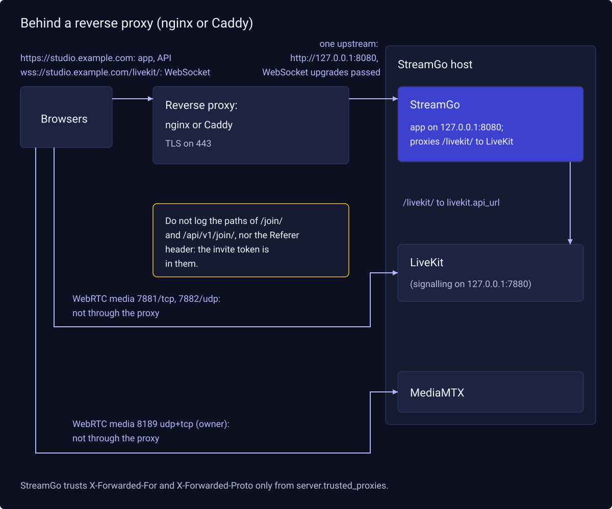

# Behind a reverse proxy

This page puts StreamGo behind nginx or Caddy, which end HTTPS on port 443 and pass requests to StreamGo on the
loopback address. StreamGo carries LiveKit's signalling under `/livekit/`, so the proxy needs **one upstream** for
everything: the app, the API, the program's WHIP requests and LiveKit's WebSocket. The WebRTC media ports do not
go through the proxy.

To serve HTTPS from StreamGo itself, without a proxy, see [Standalone HTTPS](standalone-https.md).



## StreamGo's settings

StreamGo listens on the loopback address only, knows its public URL, and trusts the proxy's forwarded headers.
In `config.toml`:

```toml
[server]
addr = "127.0.0.1:8080"
public_url = "https://studio.example.com"
trusted_proxies = ["127.0.0.1", "::1"]

[livekit]
url = ""                           # browsers get wss://studio.example.com/livekit
api_url = "http://127.0.0.1:7880"  # LiveKit's own port, on the loopback address
```

`public_url` is what people type, and the origin every state-changing request must carry: a request whose
`Origin` header differs is refused. StreamGo reads `X-Forwarded-For` and `X-Forwarded-Proto` only from the
addresses in `trusted_proxies`, and ignores them from anyone else.

**With the Compose stack**, the same settings go in `.env`. The stack sets the LiveKit URL to LiveKit's own port
by default, so set it to the `/livekit` path explicitly; publish the app's port and LiveKit's signalling port on
the loopback address only; and trust the Docker network the proxy's requests arrive from:

```bash
cat >> .env <<'EOF'
STREAMGO_SERVER_PUBLIC_URL=https://studio.example.com
STREAMGO_LIVEKIT_URL=wss://studio.example.com/livekit
STREAMGO_SERVER_TRUSTED_PROXIES=172.16.0.0/12
HTTP_PORT=127.0.0.1:8080
LIVEKIT_PORT=127.0.0.1:7880
EOF
```

```bash
make up
```

The [deployment guide](deployment.md#https-and-secure-websocket) shows the other arrangement, with LiveKit behind
a name of its own; it still works, and needs a second name and certificate.

## nginx

```nginx
# The WebSocket upgrade for /livekit/.
map $http_upgrade $connection_upgrade {
    default upgrade;
    ''      close;
}

# Invite links carry the guest's credential in the path: never log /join/ and /api/v1/join/,
# and never log the Referer header (requests made from the join page carry its address).
map $uri $streamgo_loggable {
    ~^/(api/v1/)?join/  0;
    default             1;
}
log_format streamgo '$remote_addr [$time_local] "$request_method $uri" $status $body_bytes_sent $request_time';

server {
    listen 80;
    listen [::]:80;
    server_name studio.example.com;
    return 301 https://$host$request_uri;
}

server {
    listen 443 ssl;
    listen [::]:443 ssl;
    http2 on;
    server_name studio.example.com;

    ssl_certificate     /etc/letsencrypt/live/studio.example.com/fullchain.pem;
    ssl_certificate_key /etc/letsencrypt/live/studio.example.com/privkey.pem;

    access_log /var/log/nginx/streamgo.access.log streamgo if=$streamgo_loggable;

    # Logo uploads are up to 2 MB; nginx refuses bodies over 1 MB by default.
    client_max_body_size 3m;

    location /livekit/ {
        proxy_pass http://127.0.0.1:8080;
        proxy_http_version 1.1;
        proxy_set_header Upgrade $http_upgrade;
        proxy_set_header Connection $connection_upgrade;
        proxy_set_header Host $host;
        proxy_set_header X-Forwarded-For $proxy_add_x_forwarded_for;
        proxy_set_header X-Forwarded-Proto $scheme;
        proxy_read_timeout 1h;
        proxy_send_timeout 1h;
    }

    location / {
        proxy_pass http://127.0.0.1:8080;
        proxy_http_version 1.1;
        proxy_set_header Host $host;
        proxy_set_header X-Forwarded-For $proxy_add_x_forwarded_for;
        proxy_set_header X-Forwarded-Proto $scheme;
    }
}
```

Check the configuration, then reload nginx:

```bash
sudo nginx -t
```

```bash
sudo systemctl reload nginx
```

What each part is for:

- **`/livekit/`** carries LiveKit's signalling as a WebSocket. Without the `Upgrade` and `Connection` headers the
  studio cannot connect, and without the long timeouts nginx closes a quiet connection after 60 seconds.
- **`client_max_body_size`**: StreamGo itself limits JSON and SDP bodies to 64 kB and the logo to 2 MB; nginx's
  own default of 1 MB would refuse logo uploads before StreamGo sees them.
- **The log format** records the method and the path without the query string, and leaves out the `Referer`
  header; the `map` turns the log off for the two join routes. nginx's error log also quotes the request line when
  a request fails (for example while StreamGo is restarting), so keep it as private as the access log.

## Caddy

Caddy obtains and renews the certificate by itself, passes WebSocket upgrades without extra settings, sets
`X-Forwarded-For` and `X-Forwarded-Proto`, and sets no request body limit by default:

```caddyfile
studio.example.com {
	reverse_proxy 127.0.0.1:8080
}
```

Caddy writes no access log unless a site asks for one. If you turn it on, remove the path and the `Referer`
header from it:

```caddyfile
studio.example.com {
	reverse_proxy 127.0.0.1:8080
	log {
		output file /var/log/caddy/streamgo.log
		format filter {
			request>uri delete
			request>headers>Referer delete
		}
	}
}
```

Check the configuration, then reload Caddy:

```bash
caddy validate --config /etc/caddy/Caddyfile
```

```bash
sudo systemctl reload caddy
```

## The join route is never logged

An invite link is `<public URL>/join/<token>`, and the token is the guest's credential: whoever has the link can
join the studio until the owner rotates it. StreamGo logs every request by its route pattern
(`/api/v1/join/:token`), never the raw path or query. The proxy must do the same:

- do not log the paths of `/join/` and `/api/v1/join/`, or do not log paths at all;
- do not log the `Referer` header, which carries the join page's address on the requests that page makes;
- do not send those addresses to analytics or monitoring tools.

## The media ports do not go through the proxy

LiveKit's and MediaMTX's WebRTC media are not HTTP. Browsers reach them directly, so the firewall must let them
through and LiveKit and MediaMTX must advertise an address browsers can reach:

| Port | Protocol | Service | Who connects |
|---|---|---|---|
| 443 (and 80 for the redirect) | TCP | the proxy | everyone |
| 7881 | TCP | LiveKit media | everyone in the studio |
| 7882 | UDP | LiveKit media | everyone in the studio |
| 8189 | UDP and TCP | MediaMTX media | the owner's browser |

The full list, with the ports that must stay closed, is in [Standalone HTTPS: ports](standalone-https.md#ports);
the advertised address is `NODE_IP` in the Compose stack
([Advertised addresses behind NAT](deployment.md#advertised-addresses-behind-nat)).
