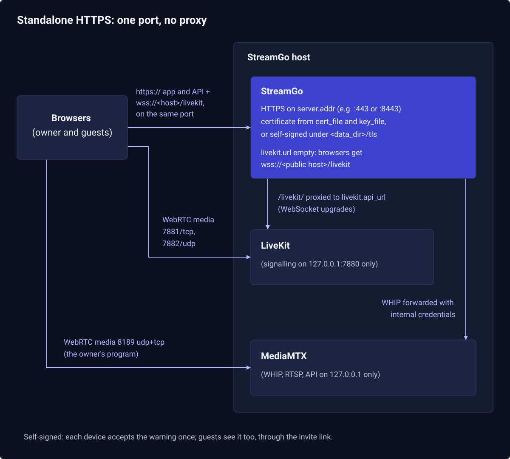
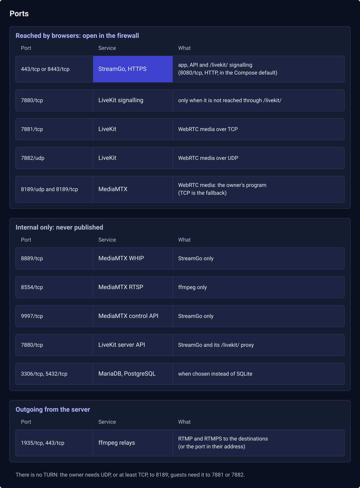

# Standalone HTTPS

StreamGo can speak HTTPS by itself, with no reverse proxy: give it a certificate, or let it generate a
self-signed one. It also carries LiveKit's signalling on the same port, under `/livekit/`, so one HTTPS port is a
complete install. This page covers the settings, both kinds of certificate, what guests see with a self-signed
one, and every port a firewall must let through.

Use a reverse proxy instead ([Behind a reverse proxy](reverse-proxy.md)) when port 443 is shared with other
sites, or when plain `http://` should redirect to `https://`.



## Why HTTPS

Browsers give a page the camera and the microphone only on a secure origin: `https://`, or `localhost` for
development. A browser on an HTTPS page also talks to LiveKit only over `wss://`, and LiveKit does not end TLS
itself. StreamGo solves both: it ends TLS for the app and passes LiveKit's signalling through to it.

## The settings

In `config.toml`:

```toml
[server]
addr = ":8443"                                   # the HTTPS port, on every interface
public_url = "https://studio.example.com:8443"   # what people type; must be https:// once HTTPS is on
trusted_proxies = []                             # no proxy in front

# one of the two:
self_signed = true                               # a certificate StreamGo generates
# cert_file = "/etc/streamgo/tls/fullchain.pem"  # or a certificate you bring, in PEM
# key_file  = "/etc/streamgo/tls/privkey.pem"

[livekit]
url = ""                                         # empty: browsers get wss://studio.example.com:8443/livekit
api_url = "http://127.0.0.1:7880"                # where StreamGo reaches LiveKit, and where /livekit/ leads
```

| Setting | Environment variable | What |
|---|---|---|
| `server.addr` | `STREAMGO_SERVER_ADDR` | The address and port StreamGo listens on; with a certificate, it speaks HTTPS there. |
| `server.public_url` | `STREAMGO_SERVER_PUBLIC_URL` | The URL people use. It must start with `https://` when HTTPS is on, or the server refuses to start. Invite links and the origin check use it. |
| `server.cert_file`, `server.key_file` | `STREAMGO_SERVER_CERT_FILE`, `STREAMGO_SERVER_KEY_FILE` | A certificate chain and its key, in PEM. They win over `self_signed`. |
| `server.self_signed` | `STREAMGO_SERVER_SELF_SIGNED` | `true`: generate and keep a self-signed certificate. |
| `livekit.url` | `STREAMGO_LIVEKIT_URL` | The LiveKit URL given to browsers. Empty: the public URL's own origin with `/livekit`, as `wss://` under HTTPS and `ws://` under HTTP. Set: given unchanged. |
| `livekit.api_url` | `STREAMGO_LIVEKIT_API_URL` | Where StreamGo reaches LiveKit's API; `/livekit/` is proxied there. |

With neither a certificate nor `self_signed`, StreamGo speaks plain HTTP, as before.

At every start, the log names the certificate in use and its SHA-256 fingerprint; it never prints the key. A
certificate that cannot be read, or a key that does not match it, stops the start with an error naming the file.

**Port 443.** Listening on a port under 1024 needs the permission to bind it (root, or the
`CAP_NET_BIND_SERVICE` capability). Without it, use a port such as 8443 and put it in `public_url`.

**The Compose stack** sets `STREAMGO_LIVEKIT_URL` to LiveKit's own port by default, so `livekit.url` is never
empty there. To use the signalling path through StreamGo, set it explicitly in `.env`, which has the same effect:

```bash
STREAMGO_LIVEKIT_URL=wss://studio.example.com:8443/livekit
```

## A certificate you bring

Point `cert_file` and `key_file` at the full chain and the key, both in PEM, for example the `fullchain.pem` and
`privkey.pem` that Let's Encrypt clients write. The certificate must cover the host of `public_url`. StreamGo
reads the files when it starts: after you renew the certificate, restart StreamGo.

The key must be readable by the user StreamGo runs as, and by nobody else.

## A self-signed certificate

Set `self_signed = true` and give no certificate files. On the first start StreamGo generates a certificate and
its key under `<data_dir>/tls`, readable only by its own user (mode 0600):

| | |
|---|---|
| Names | The host of `public_url`, `localhost` and the loopback addresses |
| Lasts | One year |
| Renewed | At a start, when the files are missing, the certificate has expired or expires within 30 days, or it no longer covers the host of `public_url` |

StreamGo reuses the same certificate at the next starts, so its fingerprint stays the same until it is renewed. It
looks at the certificate only when it starts: a server that is never restarted keeps its certificate until it
expires, so restart it at least once in the 30 days before the expiry date.

To read the fingerprint again later, run this on the server, with the certificate's file name from
`<data_dir>/tls`:

```bash
openssl x509 -noout -fingerprint -sha256 -in /path/to/data/tls/<certificate file>
```

### What people see with a self-signed certificate

Nobody trusts a self-signed certificate until told to. Each browser shows a warning the first time it opens the
site, once per device; after the warning is accepted, the camera and the microphone work.

**Guests see the same warning** when they open the invite link. Tell them before you send the link, so they
expect it. Anyone who wants to be sure they reached your server, and not someone in between, can open the
certificate details in the browser's warning page and compare its SHA-256 fingerprint with the one in your log.

To avoid the warning, use a certificate from a public authority (Let's Encrypt is free), or install the
self-signed certificate (never the key) as a trusted authority on the devices you control.

## LiveKit's signalling through `/livekit/`

StreamGo proxies everything under `/livekit/` to `livekit.api_url`, WebSocket upgrades included. With `livekit.url`
empty, browsers are told to connect to `wss://<public host>/livekit`, which reaches LiveKit over StreamGo's own
origin and certificate. The proxy forwards only to the configured LiveKit, never to a host the request names, and
it adds no credentials: LiveKit's own API still requires its key and secret.

LiveKit's signalling port can then stay on the loopback address; it does not need to be open in the firewall.
Setting `livekit.url` explicitly keeps the other arrangement, with LiveKit behind its own name or proxy.

The WebRTC media ports of LiveKit and MediaMTX are not affected: they are not HTTP, and browsers reach them
directly.

## Ports



Open these in the firewall (and forward them on a NAT router, on the same numbers):

| Port | Protocol | Service | Who connects | What |
|---|---|---|---|---|
| `server.addr`, e.g. 443 or 8443 | TCP | StreamGo | everyone | The app, the API and LiveKit's signalling under `/livekit/` |
| 7881 | TCP | LiveKit | everyone in the studio | WebRTC media over TCP |
| 7882 | UDP | LiveKit | everyone in the studio | WebRTC media over UDP |
| 8189 | UDP and TCP | MediaMTX | the owner's browser | The program, by WebRTC; TCP is the fallback |

These must **not** be open: they serve StreamGo and ffmpeg only, on the loopback address or an internal network:

| Port | Service | What |
|---|---|---|
| 7880/tcp | LiveKit | Its signalling and server API (reached through `/livekit/`) |
| 8889/tcp | MediaMTX | WHIP, used by StreamGo only |
| 8554/tcp | MediaMTX | RTSP, used by ffmpeg only |
| 9997/tcp | MediaMTX | Control API, used by StreamGo only |
| 3306/tcp, 5432/tcp | MariaDB, PostgreSQL | When used instead of SQLite |

Outgoing, the server must reach each destination's RTMP port (1935/tcp for `rtmp://` by default, 443/tcp for
most `rtmps://`, or the port in the destination's address).

The numbers above are the defaults; the Compose stack changes them with the variables in
[Install with Docker](install-docker.md#ports). LiveKit and MediaMTX must also advertise an address browsers can
reach; see [Advertised addresses behind NAT](deployment.md#advertised-addresses-behind-nat).

There is no TURN server in this version. The owner's network must allow outgoing UDP to port 8189, or at least TCP
to it, and guests' networks the same towards 7881 or 7882. A network that allows only web traffic through a proxy
cannot take part.
